# Evidências de telas

Print de cada tela do LoBank, separado pelas pastas desta pasta `telas/`. Gerado por `tools/telas/capturar.py` (branch `app-rodada-0`, commit `84ad845`), no **modo simulado** e com dados fictícios.

Para cada tela: de qual tela do Studio ela veio (board › tela e o id), **o que foi alterado** em relação ao que o Studio criou e **o motivo**. No fim de cada tópico ficam as telas do Studio que não entraram no app.

Fontes dos motivos: comentários da usuária no Studio, decisões e testes registrados em `docs/testes/friction-log.md`, e regras da API da Celcoin.

## Tópicos

Resumo de todas as telas, três por linha: [telas.md](telas.md).

- [Acesso e cadastro PF](#acesso-e-cadastro-pf): pasta `acesso/`
- [Cadastro PJ (MEI e LTDA)](#cadastro-pj-mei-e-ltda): pasta `pj/`
- [Home e Minha conta](#home-e-minha-conta): pasta `home/`
- [Pix: chaves e envio por chave](#pix-chaves-e-envio-por-chave): pasta `pix/`
- [Pix Copia e Cola e transferência por agência e conta](#pix-copia-e-cola-e-transferência-por-agência-e-conta): pasta `copia/`
- [Receber (QR Code)](#receber-qr-code): pasta `receber/`
- [Extrato](#extrato): pasta `extrato/`
- [Pagamento de contas (boleto)](#pagamento-de-contas-boleto): pasta `boleto/`

## Acesso e cadastro PF

Pasta: `acesso/`

### 1. Login

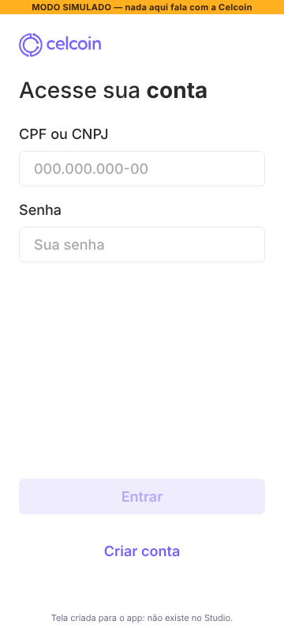

- **Rota:** `#/login`
- **Origem no Studio:** Tela nova, não existe no Studio
- **Alterado em relação ao Studio:** Tela nova, no mesmo visual (entrada com CPF ou CNPJ e senha).
- **Motivo:** Nenhum board do Studio traz tela de login, e o app precisa de uma para a pessoa voltar à conta.

### 2. Tipo de conta

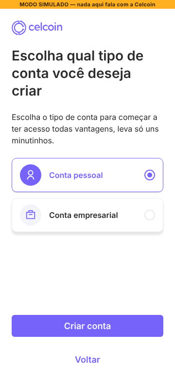

- **Rota:** `#/cadastro`
- **Origem no Studio:** Onboarding - PF › Cadastro › Tipo de conta (`b5afc529`)
- **Alterado em relação ao Studio:** Ganhou a opção "Conta empresarial", que leva ao cadastro PJ.
- **Motivo:** A Fase 2 incluiu abertura de conta PJ (MEI e LTDA).

### 3. Termos

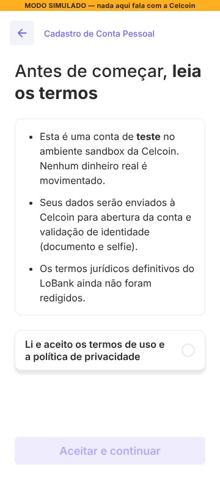

- **Rota:** `#/cadastro/termos`
- **Origem no Studio:** Onboarding - PF › Cadastro › Termos de uso (`29b9c98a`)
- **Alterado em relação ao Studio:** Texto próprio do app, avisando que é conta de teste no sandbox.
- **Motivo:** Os termos do Studio são um modelo; não há termos jurídicos reais para uma conta de teste.

### 4. CPF

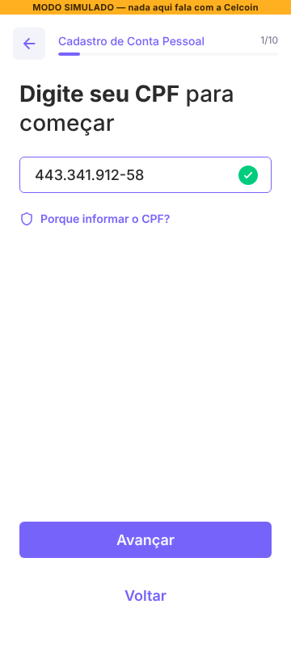

- **Rota:** `#/cadastro/cpf`
- **Origem no Studio:** Onboarding - PF › Cadastro › CPF › Empty (`8c68c085`)
- **Alterado em relação ao Studio:** Sem mudança de conteúdo: segue o HTML do Studio, que foi lido por inteiro.
- **Motivo:** —

### 5. Nome completo

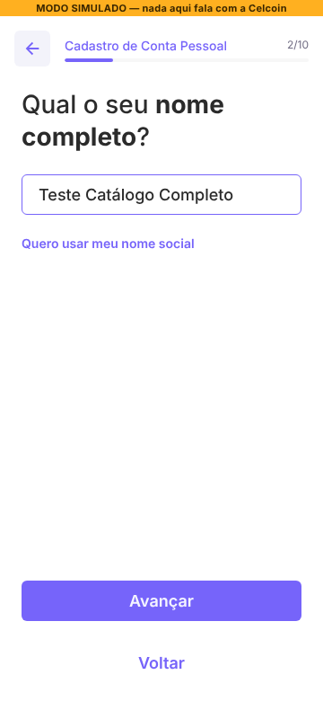

- **Rota:** `#/cadastro/nome`
- **Origem no Studio:** Onboarding - PF › Cadastro › Nome Completo (`4ce68921`)
- **Alterado em relação ao Studio:** Montada com o modelo comum das telas do Studio (mesma estrutura, componentes e textos de apoio); o HTML próprio desta tela não foi lido.
- **Motivo:** Cada tela do Studio tem cerca de 25 KB de HTML e não cabia ler todas na sessão: só 9 telas-base foram lidas por inteiro e as outras seguiram o modelo delas.

### 6. Data de nascimento

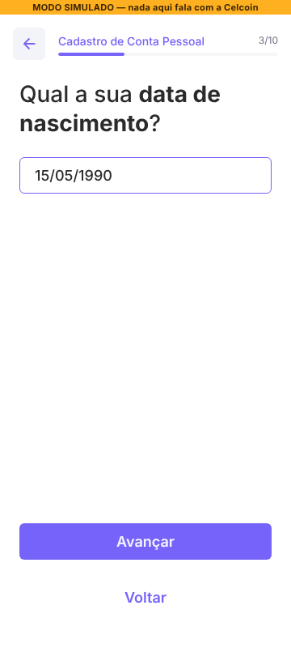

- **Rota:** `#/cadastro/nascimento`
- **Origem no Studio:** Onboarding - PF › Cadastro › Data de Nascimento (`e4896803`)
- **Alterado em relação ao Studio:** Montada com o modelo comum das telas do Studio (mesma estrutura, componentes e textos de apoio); o HTML próprio desta tela não foi lido.
- **Motivo:** Cada tela do Studio tem cerca de 25 KB de HTML e não cabia ler todas na sessão: só 9 telas-base foram lidas por inteiro e as outras seguiram o modelo delas.

### 7. Nome da mãe

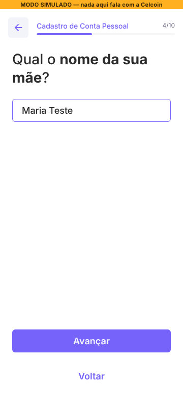

- **Rota:** `#/cadastro/mae`
- **Origem no Studio:** Onboarding - PF › Cadastro › Nome da mãe (`32f1dda4`)
- **Alterado em relação ao Studio:** Montada com o modelo comum das telas do Studio (mesma estrutura, componentes e textos de apoio); o HTML próprio desta tela não foi lido.
- **Motivo:** Cada tela do Studio tem cerca de 25 KB de HTML e não cabia ler todas na sessão: só 9 telas-base foram lidas por inteiro e as outras seguiram o modelo delas.

### 8. Dados financeiros

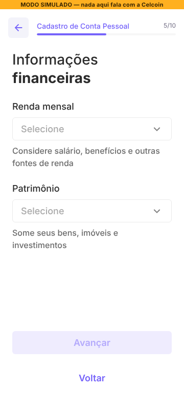

- **Rota:** `#/cadastro/financeiro`
- **Origem no Studio:** Onboarding - PF › Cadastro › Informações Financeiras (`6c59f729`)
- **Alterado em relação ao Studio:** Sem mudança de conteúdo: segue o HTML do Studio, que foi lido por inteiro.
- **Motivo:** —

### 9. Dados financeiros: escolher renda

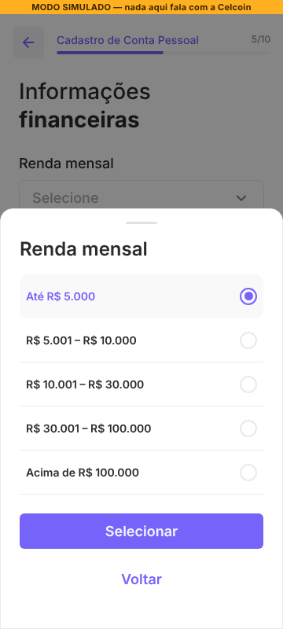

- **Rota:** `#/cadastro/financeiro`
- **Origem no Studio:** Onboarding - PF › Cadastro › Informações Financeiras (`6c59f729`)
- **Alterado em relação ao Studio:** Modal de escolha da faixa de renda, no padrão de modal do Studio.
- **Motivo:** A tela do Studio mostra o campo; a lista de faixas precisava de um seletor.

### 10. Profissão

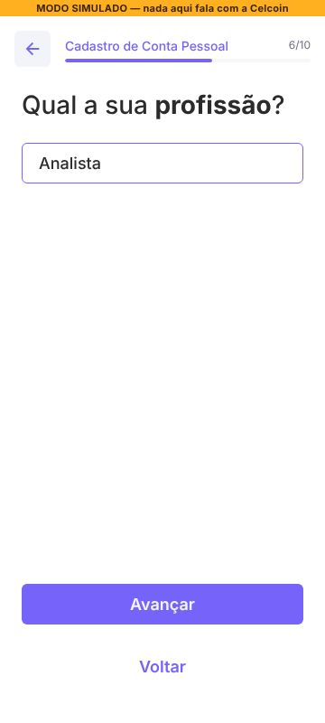

- **Rota:** `#/cadastro/profissao`
- **Origem no Studio:** Onboarding - PF › Cadastro › Profissão (`e6d262a4`)
- **Alterado em relação ao Studio:** Montada com o modelo comum das telas do Studio (mesma estrutura, componentes e textos de apoio); o HTML próprio desta tela não foi lido.
- **Motivo:** Cada tela do Studio tem cerca de 25 KB de HTML e não cabia ler todas na sessão: só 9 telas-base foram lidas por inteiro e as outras seguiram o modelo delas.

### 11. Pessoa politicamente exposta

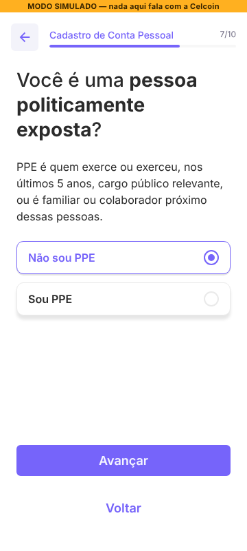

- **Rota:** `#/cadastro/ppe`
- **Origem no Studio:** Onboarding - PF › Cadastro › PPE (`d2d983a6`)
- **Alterado em relação ao Studio:** Montada com o modelo comum das telas do Studio (mesma estrutura, componentes e textos de apoio); o HTML próprio desta tela não foi lido.
- **Motivo:** Cada tela do Studio tem cerca de 25 KB de HTML e não cabia ler todas na sessão: só 9 telas-base foram lidas por inteiro e as outras seguiram o modelo delas.

### 12. E-mail

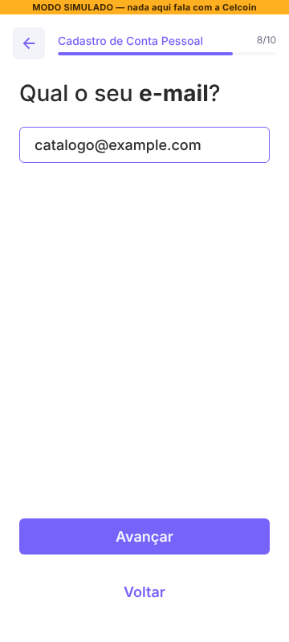

- **Rota:** `#/cadastro/email`
- **Origem no Studio:** Onboarding - PF › Cadastro › E-mail (`14f9c591`)
- **Alterado em relação ao Studio:** Montada com o modelo comum das telas do Studio (mesma estrutura, componentes e textos de apoio); o HTML próprio desta tela não foi lido.
- **Motivo:** Cada tela do Studio tem cerca de 25 KB de HTML e não cabia ler todas na sessão: só 9 telas-base foram lidas por inteiro e as outras seguiram o modelo delas.

### 13. Celular

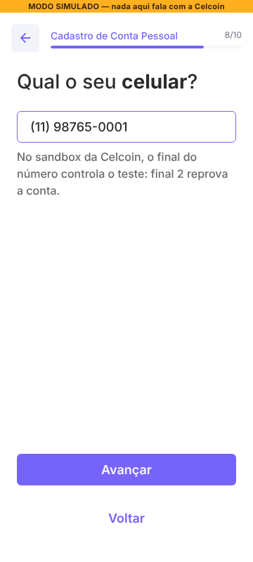

- **Rota:** `#/cadastro/telefone`
- **Origem no Studio:** Onboarding - PF › Cadastro › Telefone (`88f00de4`)
- **Alterado em relação ao Studio:** Igual ao modelo, mas **sem** a etapa seguinte de código por SMS.
- **Motivo:** A Celcoin não envia SMS no sandbox e a skill proíbe usar código fixo; decisão da usuária na Rodada 0.

### 14. Endereço: buscar ou digitar

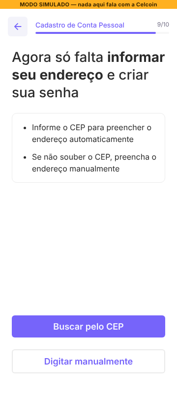

- **Rota:** `#/cadastro/endereco`
- **Origem no Studio:** Onboarding - PF › Cadastro › Endereço › Seleção (`8ad720e3`)
- **Alterado em relação ao Studio:** "Permitir localização" virou "Buscar pelo CEP"; a opção "Digitar manualmente" continua.
- **Motivo:** O app não tem serviço de endereço por coordenadas; o CEP é consultado no ViaCEP.

### 15. Endereço: CEP encontrado

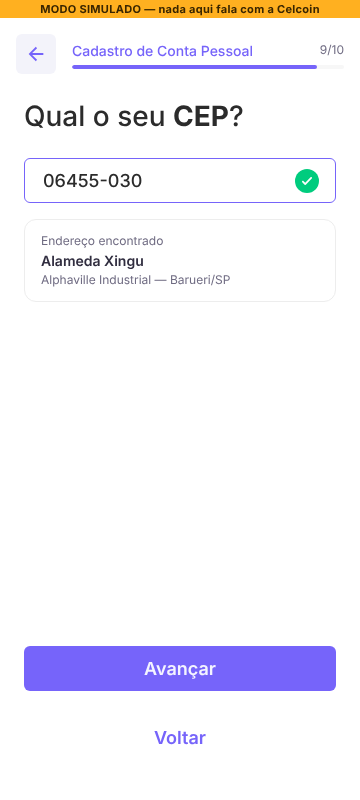

- **Rota:** `#/cadastro/endereco/cep`
- **Origem no Studio:** Onboarding - PF › Cadastro › Endereço › Encontre seu CEP (`8258942a`)
- **Alterado em relação ao Studio:** Junta "Encontre seu CEP" e "Confirmação" numa tela só.
- **Motivo:** Com o CEP, o endereço já aparece; a etapa de confirmação separada ficou redundante.

### 16. Endereço: número e complemento

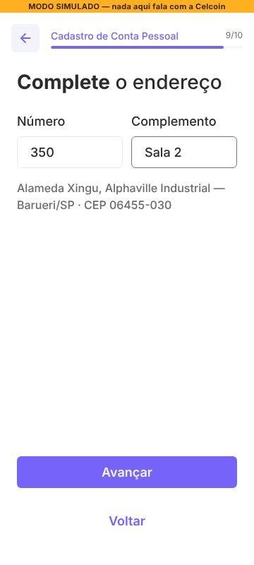

- **Rota:** `#/cadastro/endereco/complemento`
- **Origem no Studio:** Onboarding - PF › Cadastro › Endereço › Complete o endereço (`21fce59c`)
- **Alterado em relação ao Studio:** Montada com o modelo comum das telas do Studio (mesma estrutura, componentes e textos de apoio); o HTML próprio desta tela não foi lido.
- **Motivo:** Cada tela do Studio tem cerca de 25 KB de HTML e não cabia ler todas na sessão: só 9 telas-base foram lidas por inteiro e as outras seguiram o modelo delas.

### 17. Endereço manual

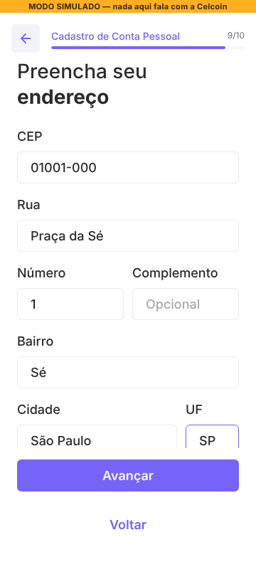

- **Rota:** `#/cadastro/endereco/manual`
- **Origem no Studio:** Onboarding - PF › Cadastro › Endereço › Preencher endereço manualmente (`aa4e8aab`)
- **Alterado em relação ao Studio:** Montada com o modelo comum das telas do Studio (mesma estrutura, componentes e textos de apoio); o HTML próprio desta tela não foi lido.
- **Motivo:** Cada tela do Studio tem cerca de 25 KB de HTML e não cabia ler todas na sessão: só 9 telas-base foram lidas por inteiro e as outras seguiram o modelo delas.

### 18. Senha de acesso

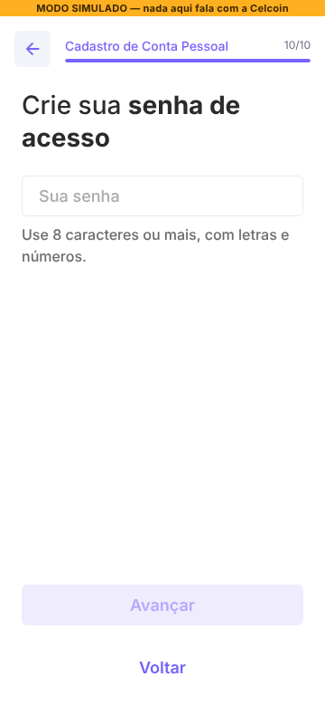

- **Rota:** `#/cadastro/senha`
- **Origem no Studio:** Onboarding - PF › Cadastro › Criar senha (`152226d7`)
- **Alterado em relação ao Studio:** Montada com o modelo comum das telas do Studio (mesma estrutura, componentes e textos de apoio); o HTML próprio desta tela não foi lido.
- **Motivo:** Cada tela do Studio tem cerca de 25 KB de HTML e não cabia ler todas na sessão: só 9 telas-base foram lidas por inteiro e as outras seguiram o modelo delas.

### 19. Confirmar senha

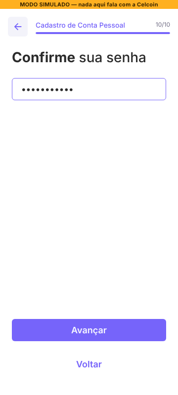

- **Rota:** `#/cadastro/senha/confirmar`
- **Origem no Studio:** Onboarding - PF › Cadastro › Confirmar senha (`abe9e59d`)
- **Alterado em relação ao Studio:** Montada com o modelo comum das telas do Studio (mesma estrutura, componentes e textos de apoio); o HTML próprio desta tela não foi lido.
- **Motivo:** Cada tela do Studio tem cerca de 25 KB de HTML e não cabia ler todas na sessão: só 9 telas-base foram lidas por inteiro e as outras seguiram o modelo delas.

### 20. Senha de transferência

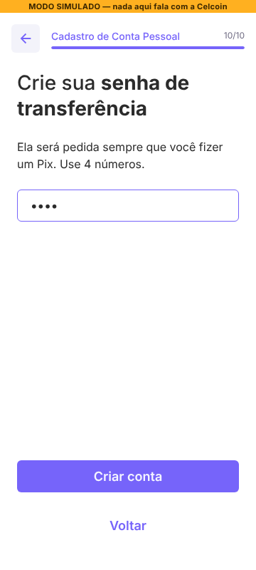

- **Rota:** `#/cadastro/senha-transferencia`
- **Origem no Studio:** Onboarding - PF › Cadastro › Criar senha transferência (`c0c0f928`)
- **Alterado em relação ao Studio:** Montada com o modelo comum das telas do Studio (mesma estrutura, componentes e textos de apoio); o HTML próprio desta tela não foi lido.
- **Motivo:** Cada tela do Studio tem cerca de 25 KB de HTML e não cabia ler todas na sessão: só 9 telas-base foram lidas por inteiro e as outras seguiram o modelo delas.

### 21. Cadastro enviado (espera de 10 s)

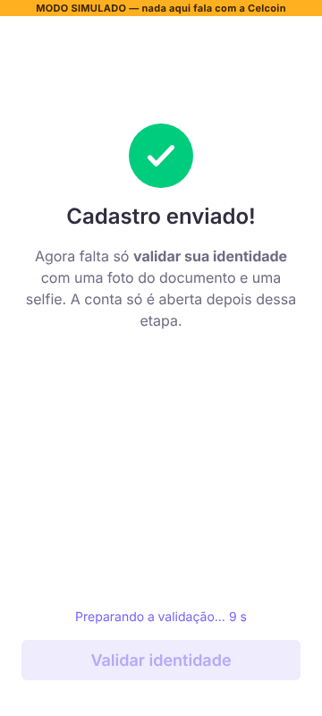

- **Rota:** `#/cadastro/sucesso`
- **Origem no Studio:** Onboarding - PF › Cadastro › Sucesso (`6095742f`)
- **Alterado em relação ao Studio:** Base no "Sucesso" do Studio, com contagem de 10 s antes de liberar "Validar identidade".
- **Motivo:** No teste, a validação deu erro logo depois da proposta porque a Celcoin ainda não tinha processado; pedido da usuária.

### 22. Validação de identidade

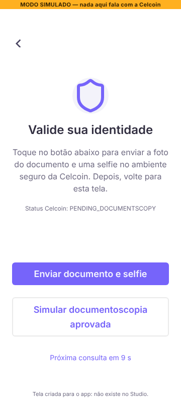

- **Rota:** `#/validacao`
- **Origem no Studio:** Tela nova, não existe no Studio
- **Alterado em relação ao Studio:** Tela nova: leva ao link de documentoscopia (celcoin.cadastro.io) e acompanha o status da proposta.
- **Motivo:** O Studio não tem a etapa de validação; a Celcoin exige a documentoscopia para abrir a conta.

### Telas do Studio que não entraram no app

| Tela do Studio | Motivo |
|---|---|
| Onboarding - PF › Splashscreen (`f5b2ed63`) | Decisão da usuária na Rodada 0. |
| Onboarding - PF › Onboarding v.1 (`125fefda`) | Decisão da usuária na Rodada 0. |
| Onboarding - PF › Onboarding v.2 (`92fc57f5`) | Decisão da usuária na Rodada 0. |
| Onboarding - PF › Onboarding v.3 (`96e789f9`) | Decisão da usuária na Rodada 0. |
| Onboarding - PF › Onboarding v.4 (`e622e12c`) | Decisão da usuária na Rodada 0. |
| Onboarding - PF › Cadastro › Telefone › Autenticação (`e4f1f437`) | A Celcoin não envia SMS no sandbox e a skill proíbe código fixo; decisão da usuária. |
| Onboarding - PF › Cadastro › Endereço › Confirmação (`5e8d2cef`) | Juntada com "Encontre seu CEP". |
| Onboarding - PF › Cadastro › Endereço › Encontre seu CEP › Selecione seu endereço (`a2602f33`) | O ViaCEP devolve um endereço por CEP; não há lista para escolher. |

## Cadastro PJ (MEI e LTDA)

Pasta: `pj/`

### 1. Tipo de conta PJ

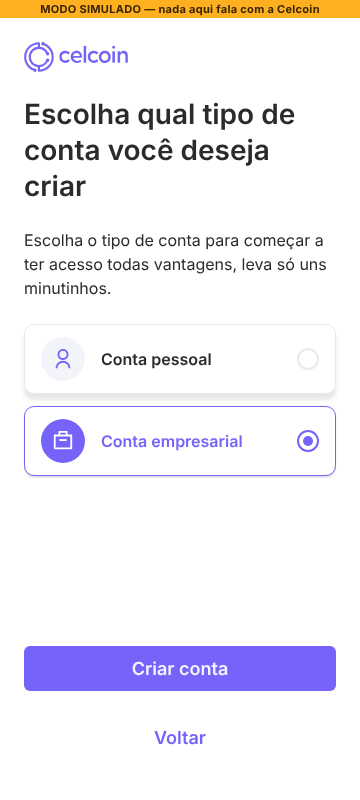

- **Rota:** `#/cadastro`
- **Origem no Studio:** Onboarding - PF › Cadastro › Tipo de conta (`b5afc529`)
- **Alterado em relação ao Studio:** Mesma tela do cadastro PF, com "Conta empresarial" marcada.
- **Motivo:** O app usa uma tela de tipo de conta para os dois fluxos.

### 2. Termos PJ

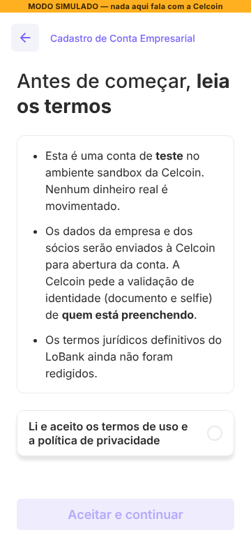

- **Rota:** `#/cadastro-pj/termos`
- **Origem no Studio:** Onboarding - PJ › Termos de uso (`58d0ae68`)
- **Alterado em relação ao Studio:** Texto próprio do app, como no PF.
- **Motivo:** Conta de teste no sandbox.

### 3. Tipo de empresa

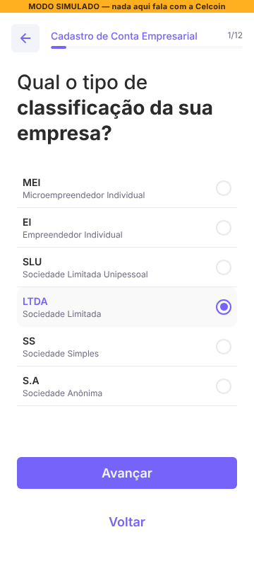

- **Rota:** `#/cadastro-pj/tipo`
- **Origem no Studio:** Onboarding - PJ › Tipo de empresa (`c1ad4ca7`)
- **Alterado em relação ao Studio:** Mostra os 6 tipos do Studio, mas envia à Celcoin só MEI ou PJ.
- **Motivo:** A API de proposta PJ só aceita `companyType` PJ ou MEI.

### 4. CNPJ

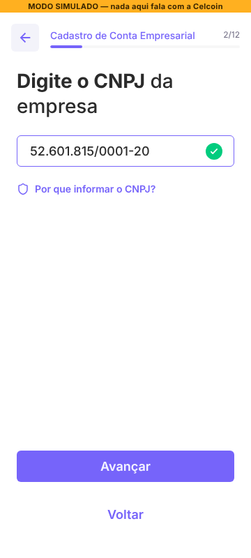

- **Rota:** `#/cadastro-pj/cnpj`
- **Origem no Studio:** Onboarding - PJ › CNPJ (`2562ee5b`); Onboarding - PJ › CNPJ › Modal › Por que o CNPJ (`b0dac0a4`)
- **Alterado em relação ao Studio:** Montada com o modelo comum das telas do Studio (mesma estrutura, componentes e textos de apoio); o HTML próprio desta tela não foi lido.
- **Motivo:** Cada tela do Studio tem cerca de 25 KB de HTML e não cabia ler todas na sessão: só 9 telas-base foram lidas por inteiro e as outras seguiram o modelo delas.

### 5. Por que pedimos o CNPJ

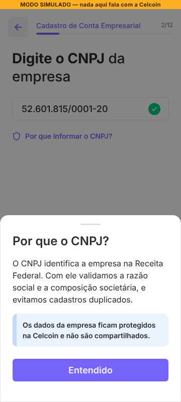

- **Rota:** `#/cadastro-pj/cnpj`
- **Origem no Studio:** Onboarding - PJ › CNPJ (`2562ee5b`); Onboarding - PJ › CNPJ › Modal › Por que o CNPJ (`b0dac0a4`)
- **Alterado em relação ao Studio:** Montada com o modelo comum das telas do Studio (mesma estrutura, componentes e textos de apoio); o HTML próprio desta tela não foi lido.
- **Motivo:** Cada tela do Studio tem cerca de 25 KB de HTML e não cabia ler todas na sessão: só 9 telas-base foram lidas por inteiro e as outras seguiram o modelo delas.

### 6. Razão social

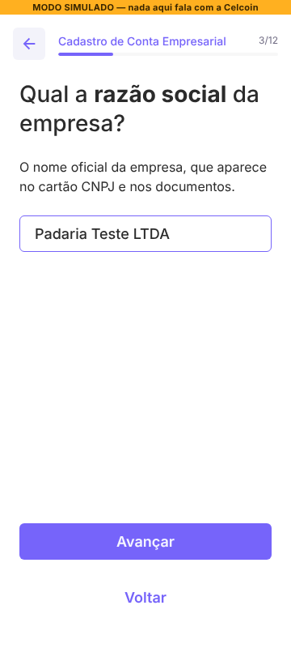

- **Rota:** `#/cadastro-pj/razao-social`
- **Origem no Studio:** Onboarding - PJ › Razão social (`3ae92d6a`)
- **Alterado em relação ao Studio:** Montada com o modelo comum das telas do Studio (mesma estrutura, componentes e textos de apoio); o HTML próprio desta tela não foi lido.
- **Motivo:** Cada tela do Studio tem cerca de 25 KB de HTML e não cabia ler todas na sessão: só 9 telas-base foram lidas por inteiro e as outras seguiram o modelo delas.

### 7. Nome fantasia

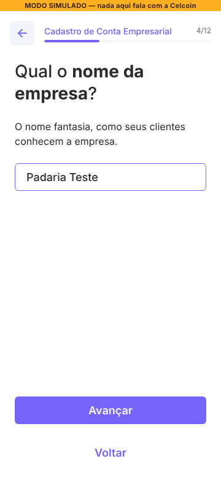

- **Rota:** `#/cadastro-pj/nome`
- **Origem no Studio:** Onboarding - PJ › Nome da empresa (`0acf6c9a`)
- **Alterado em relação ao Studio:** Montada com o modelo comum das telas do Studio (mesma estrutura, componentes e textos de apoio); o HTML próprio desta tela não foi lido.
- **Motivo:** Cada tela do Studio tem cerca de 25 KB de HTML e não cabia ler todas na sessão: só 9 telas-base foram lidas por inteiro e as outras seguiram o modelo delas.

### 8. Faturamento

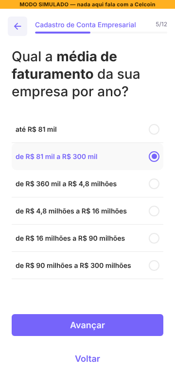

- **Rota:** `#/cadastro-pj/faturamento`
- **Origem no Studio:** Onboarding - PJ › Faturamento (`3e11977a`)
- **Alterado em relação ao Studio:** Montada com o modelo comum das telas do Studio (mesma estrutura, componentes e textos de apoio); o HTML próprio desta tela não foi lido.
- **Motivo:** Cada tela do Studio tem cerca de 25 KB de HTML e não cabia ler todas na sessão: só 9 telas-base foram lidas por inteiro e as outras seguiram o modelo delas.

### 9. Contato da empresa

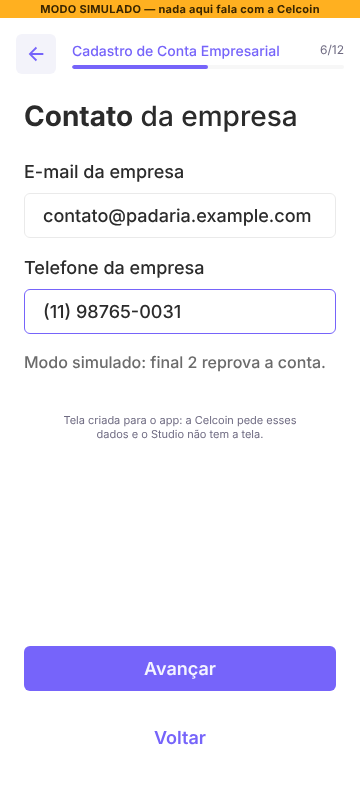

- **Rota:** `#/cadastro-pj/contato`
- **Origem no Studio:** Tela nova, não existe no Studio
- **Alterado em relação ao Studio:** Tela nova, no mesmo visual (e-mail e telefone da empresa).
- **Motivo:** O Studio não coleta esses dados e a Celcoin exige.

### 10. Endereço da empresa

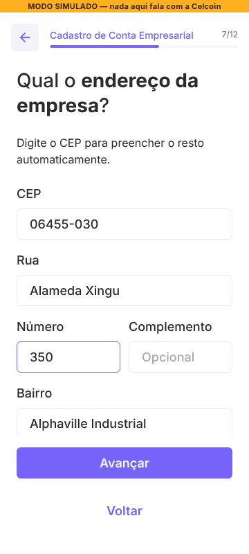

- **Rota:** `#/cadastro-pj/endereco`
- **Origem no Studio:** Tela nova, não existe no Studio
- **Alterado em relação ao Studio:** Tela nova, no mesmo visual, com busca por CEP.
- **Motivo:** O Studio não coleta o endereço da empresa e a Celcoin exige.

### 11. Quem está abrindo a conta

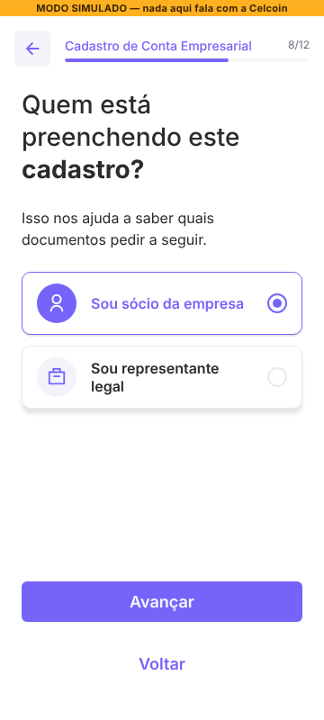

- **Rota:** `#/cadastro-pj/quem`
- **Origem no Studio:** Onboarding - PJ › Quem está preenchendo (`728d5ec6`)
- **Alterado em relação ao Studio:** No MEI só aparece "Sou sócio".
- **Motivo:** A Celcoin recusa MEI com mais de um sócio ou com representante ("o campo owner deve conter apenas um SOCIO").

### 12. Seus dados (responsável)

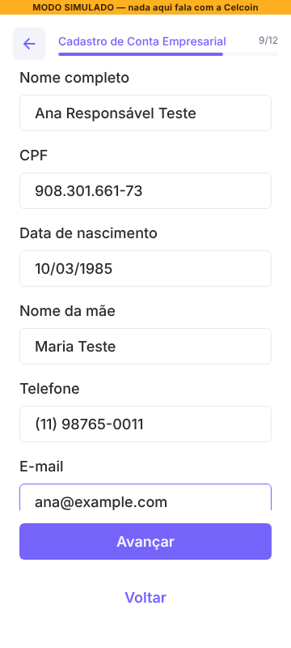

- **Rota:** `#/cadastro-pj/seus-dados`
- **Origem no Studio:** Onboarding - PJ › Seus dados (`277d3802`)
- **Alterado em relação ao Studio:** Acrescentou nome da mãe, nascimento, telefone e e-mail.
- **Motivo:** Campos exigidos pela Celcoin para cada pessoa da proposta.

### 13. Seu endereço

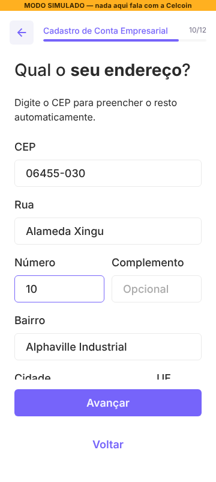

- **Rota:** `#/cadastro-pj/seu-endereco`
- **Origem no Studio:** Tela nova, não existe no Studio
- **Alterado em relação ao Studio:** Tela nova, no mesmo visual.
- **Motivo:** A Celcoin exige o endereço do responsável e o Studio não pede.

### 14. Sócios (vazio)

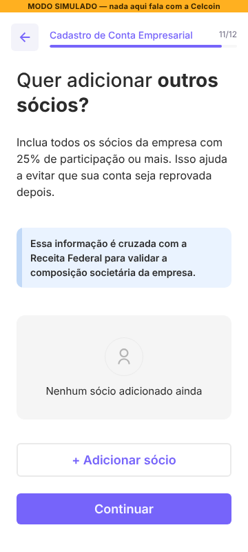

- **Rota:** `#/cadastro-pj/socios`
- **Origem no Studio:** Onboarding - PJ › Adicionar sócios (`a631c7eb`); Onboarding - PJ › Modal › Adicionar sócio (`0f726f1e`)
- **Alterado em relação ao Studio:** Montada com o modelo comum das telas do Studio (mesma estrutura, componentes e textos de apoio); o HTML próprio desta tela não foi lido.
- **Motivo:** Cada tela do Studio tem cerca de 25 KB de HTML e não cabia ler todas na sessão: só 9 telas-base foram lidas por inteiro e as outras seguiram o modelo delas.

### 15. Adicionar sócio PF

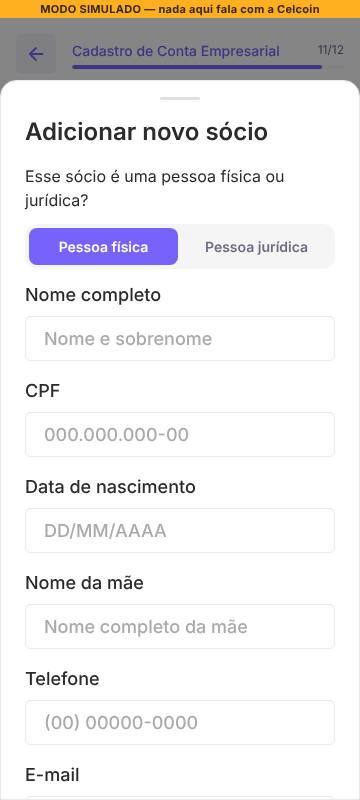

- **Rota:** `#/cadastro-pj/socios`
- **Origem no Studio:** Onboarding - PJ › Adicionar sócios (`a631c7eb`); Onboarding - PJ › Modal › Adicionar sócio (`0f726f1e`)
- **Alterado em relação ao Studio:** O modal ganhou nascimento, mãe, telefone, e-mail e endereço; a participação (%) fica só no app.
- **Motivo:** A Celcoin exige esses dados de cada sócio e não tem campo de participação.

### 16. Adicionar sócio PJ

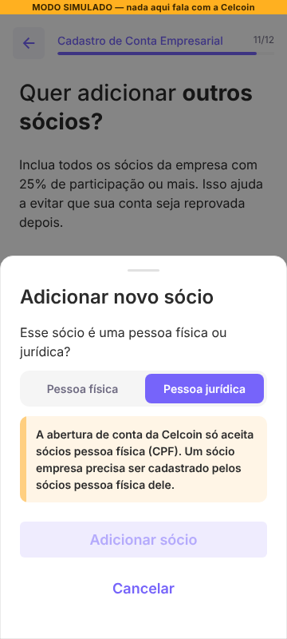

- **Rota:** `#/cadastro-pj/socios`
- **Origem no Studio:** Onboarding - PJ › Adicionar sócios (`a631c7eb`); Onboarding - PJ › Modal › Adicionar sócio (`0f726f1e`)
- **Alterado em relação ao Studio:** A opção existe, mas avisa que sócio pessoa jurídica não pode ser cadastrado.
- **Motivo:** O `owner` da proposta só aceita CPF; item para validar com a Celcoin.

### 17. Sócios (lista)

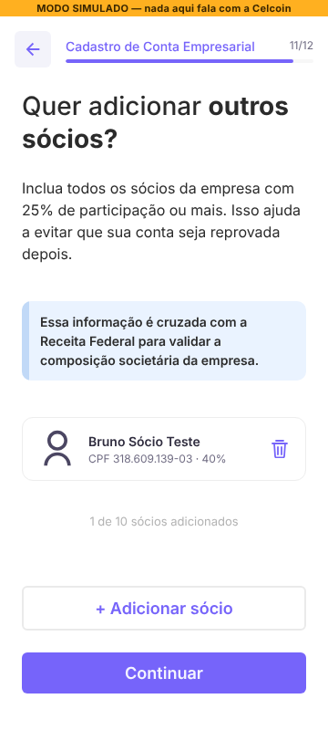

- **Rota:** `#/cadastro-pj/socios`
- **Origem no Studio:** Onboarding - PJ › Adicionar sócios (`a631c7eb`); Onboarding - PJ › Modal › Adicionar sócio (`0f726f1e`)
- **Alterado em relação ao Studio:** Montada com o modelo comum das telas do Studio (mesma estrutura, componentes e textos de apoio); o HTML próprio desta tela não foi lido.
- **Motivo:** Cada tela do Studio tem cerca de 25 KB de HTML e não cabia ler todas na sessão: só 9 telas-base foram lidas por inteiro e as outras seguiram o modelo delas.

### 18. Cadastro PJ enviado

- **Rota:** `#/cadastro/sucesso`
- **Origem no Studio:** Onboarding - PF › Cadastro › Sucesso (`6095742f`)
- **Alterado em relação ao Studio:** Igual ao PF, com a espera de 10 s.
- **Motivo:** Mesmo motivo do PF.

### 19. Validação: link do responsável

- **Rota:** `#/validacao`
- **Origem no Studio:** Tela nova, não existe no Studio
- **Alterado em relação ao Studio:** Mostra um link de documentoscopia só para o primeiro responsável.
- **Motivo:** No teste da LTDA com 2 sócios, a Celcoin gerou um único link, do primeiro owner.

### 20. Tipo de empresa: MEI

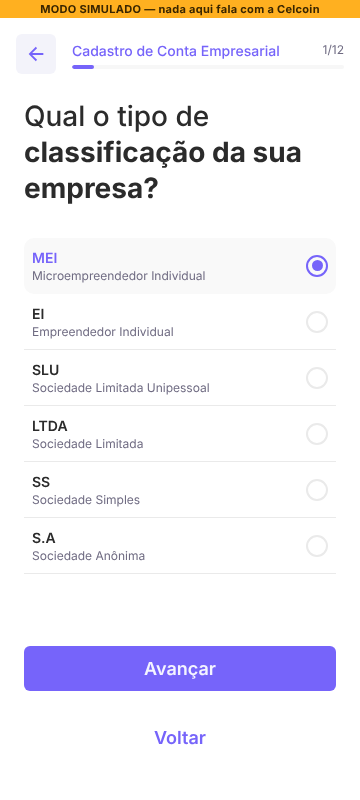

- **Rota:** `#/cadastro-pj/tipo`
- **Origem no Studio:** Onboarding - PJ › Tipo de empresa (`c1ad4ca7`)
- **Alterado em relação ao Studio:** Escolhendo MEI, o fluxo pula a tela de sócios.
- **Motivo:** Regra da Celcoin para MEI (um único sócio, o titular).

### Telas do Studio que não entraram no app

| Tela do Studio | Motivo |
|---|---|
| Onboarding - PJ › Procuração (`31bef6d3`) | comentário no Studio: "Essa tela não deve ser criada no app". |

## Home e Minha conta

Pasta: `home/`

### 1. Home sem saldo

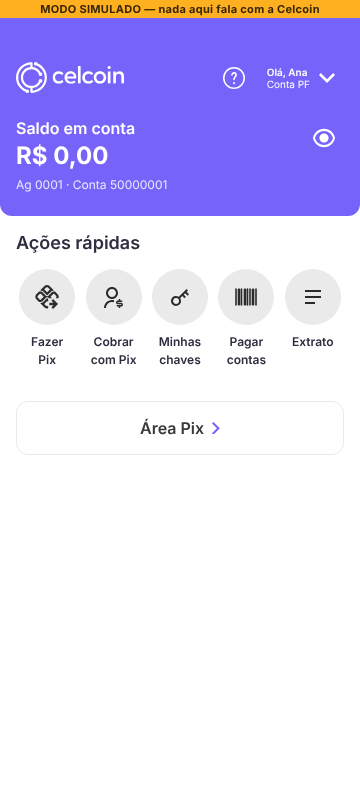

- **Rota:** `#/home`
- **Origem no Studio:** Wallet › Home (`82e58028`)
- **Alterado em relação ao Studio:** Sem cartão de crédito, "Solicitar crédito" e atalhos que não funcionam; atalhos reorganizados.
- **Motivo:** comentário no Studio: "Não deve ter a parte de cartão de credito nem solicitar um credito"; e a regra "mostrar só o que funciona".

### 2. Home

- **Rota:** `#/home`
- **Origem no Studio:** Wallet › Home (`82e58028`)
- **Alterado em relação ao Studio:** Atalhos: Fazer Pix, Cobrar com Pix, Minhas chaves, Pagar contas e Extrato.
- **Motivo:** Mesma regra; "Pagar contas" entrou com o módulo de boleto.

### 3. Fazer Pix: escolher forma

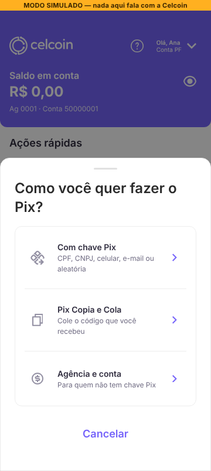

- **Rota:** `#/home`
- **Origem no Studio:** Tela nova, não existe no Studio
- **Alterado em relação ao Studio:** Modal novo com chave, Copia e Cola e agência e conta.
- **Motivo:** Pedido da usuária: "Fazer Pix" só oferecia chave.

### 4. Menu

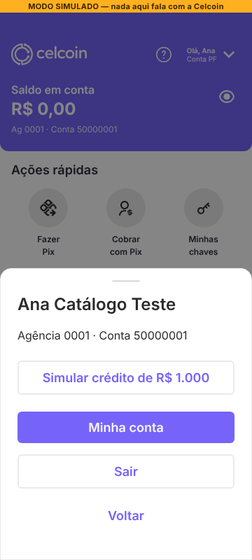

- **Rota:** `#/home`
- **Origem no Studio:** Tela nova, não existe no Studio
- **Alterado em relação ao Studio:** Menu da conta com "Minha conta" e "Sair" (e crédito simulado só no modo simulado).
- **Motivo:** Acesso aos dados da conta sem sair da Home.

### 5. Minha conta

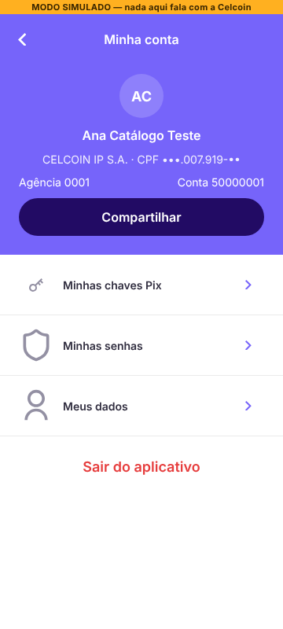

- **Rota:** `#/minha-conta`
- **Origem no Studio:** Wallet › Minha conta (`2d3d03ce`)
- **Alterado em relação ao Studio:** Só Minhas chaves, Minhas senhas, Meus dados e Sair.
- **Motivo:** Saíram Gestão de usuário, Limites, Tarifas, DDA, Dúvidas e Cancelar conta: não há API usada para eles.

### 6. Meus dados

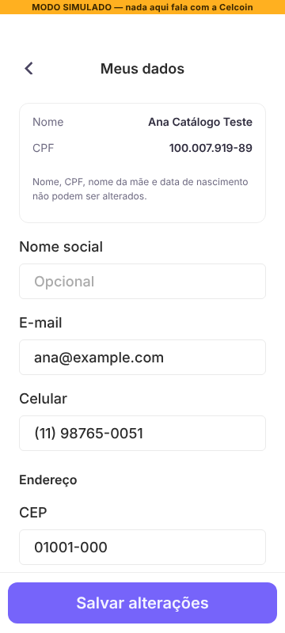

- **Rota:** `#/minha-conta/dados`
- **Origem no Studio:** Wallet › Minha conta › Editar dados (`d5ea723e`)
- **Alterado em relação ao Studio:** Só telefone, e-mail, endereço (e nome social na PF) podem ser alterados.
- **Motivo:** A Celcoin não deixa mudar nome, documento, mãe e nascimento (PF), nem razão social, nome fantasia e sócios (PJ).

### 7. Minhas senhas

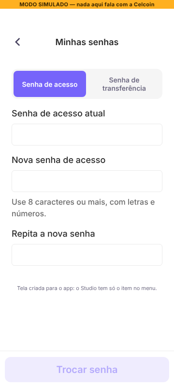

- **Rota:** `#/minha-conta/senhas`
- **Origem no Studio:** Tela nova, não existe no Studio (no modelo de Wallet › Minha conta (`2d3d03ce`))
- **Alterado em relação ao Studio:** Tela nova, no visual do Minha conta.
- **Motivo:** O item existe no Minha conta do Studio, mas a tela não.

## Pix: chaves e envio por chave

Pasta: `pix/`

### 1. Área Pix

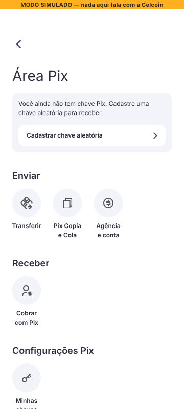

- **Rota:** `#/pix`
- **Origem no Studio:** Área Pix › Home (`08689cca`)
- **Alterado em relação ao Studio:** Sem Pix Automático e Minha agenda Pix; ganhou Copia e Cola e agência e conta.
- **Motivo:** comentário no Studio: "Retirar Pix Automatico e minha agenda pix".

### 2. Minhas chaves (vazio)

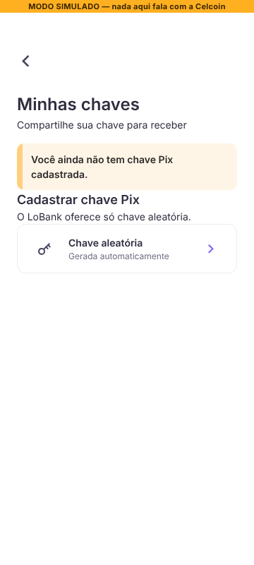

- **Rota:** `#/pix/chaves`
- **Origem no Studio:** Chaves Pix › Minhas chaves Pix (`7be5f818`)
- **Alterado em relação ao Studio:** Só chave aleatória (EVP).
- **Motivo:** comentário no Studio: "Quero oferecer somente chave Aleatoria EVP dessa forma não é necessario validação OTP".

### 3. Criar chave aleatória

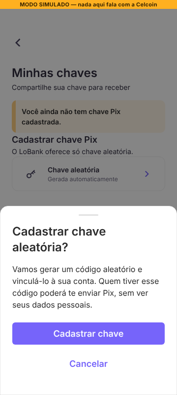

- **Rota:** `#/pix/chaves`
- **Origem no Studio:** Chaves Pix › Confirmação de criação de chave (v.2) (`508e7b00`)
- **Alterado em relação ao Studio:** Confirmação simples, sem código OTP.
- **Motivo:** comentário no Studio: "Quero oferecer somente chave Aleatoria EVP dessa forma não é necessario validação OTP".

### 4. Minhas chaves

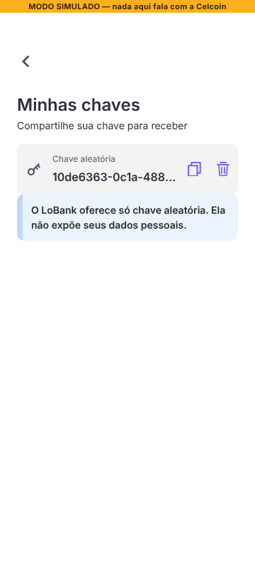

- **Rota:** `#/pix/chaves`
- **Origem no Studio:** Chaves Pix › Minhas chaves Pix (`7be5f818`)
- **Alterado em relação ao Studio:** Ganhou o botão de excluir chave.
- **Motivo:** Pedido da usuária durante os testes.

### 5. Chave não encontrada

- **Rota:** `#/pix/transferir`
- **Origem no Studio:** Transferir › Chave Pix › Informar chave (`5196768b`); Transferir › Chave Pix › Informar chave › Erro (`b14ad19f`); Transferir › Chave Pix › Informar chave › Preenchido (`2b4b209e`)
- **Alterado em relação ao Studio:** Sem mudança de conteúdo: segue o HTML do Studio, que foi lido por inteiro.
- **Motivo:** —

### 6. Chave do destinatário

- **Rota:** `#/pix/transferir`
- **Origem no Studio:** Transferir › Chave Pix › Informar chave (`5196768b`); Transferir › Chave Pix › Informar chave › Erro (`b14ad19f`); Transferir › Chave Pix › Informar chave › Preenchido (`2b4b209e`)
- **Alterado em relação ao Studio:** Sem mudança de conteúdo: segue o HTML do Studio, que foi lido por inteiro.
- **Motivo:** —

### 7. Valor do Pix

- **Rota:** `#/pix/transferir/valor`
- **Origem no Studio:** Transferir › Chave Pix › Valor da transferência (`02f83ffc`)
- **Alterado em relação ao Studio:** Montada com o modelo comum das telas do Studio (mesma estrutura, componentes e textos de apoio); o HTML próprio desta tela não foi lido.
- **Motivo:** Cada tela do Studio tem cerca de 25 KB de HTML e não cabia ler todas na sessão: só 9 telas-base foram lidas por inteiro e as outras seguiram o modelo delas.

### 8. Revisão do Pix

- **Rota:** `#/pix/transferir/revisao`
- **Origem no Studio:** Transferir › Chave Pix › Revisão e saldo (`733b240c`)
- **Alterado em relação ao Studio:** Sem agendamento e sem "Favoritar contato".
- **Motivo:** Agendamento retirado por decisão da usuária; favoritos sem dados reais.

### 9. Senha de transferência

- **Rota:** `#/pix/transferir/revisao`
- **Origem no Studio:** Tela nova, não existe no Studio
- **Alterado em relação ao Studio:** Modal de senha de 4 números, no visual dos modais do Studio.
- **Motivo:** O Studio não desenha a confirmação por senha; a senha de transferência é pedida em todo pagamento.

### 10. Pix: consultando em 10 s

- **Rota:** `#/pix/transferencia/:id`
- **Origem no Studio:** Transferir › Chave Pix › Sucesso (`caca6a53`)
- **Alterado em relação ao Studio:** Estado novo de "em processamento" com contagem de 10 s.
- **Motivo:** O pagamento volta `PROCESSING`; a usuária pediu esperar 10 s com o tempo na tela antes de consultar.

### 11. Pix enviado

- **Rota:** `#/pix/transferencia/:id`
- **Origem no Studio:** Transferir › Chave Pix › Sucesso (`caca6a53`)
- **Alterado em relação ao Studio:** Montada com o modelo comum das telas do Studio (mesma estrutura, componentes e textos de apoio); o HTML próprio desta tela não foi lido.
- **Motivo:** Cada tela do Studio tem cerca de 25 KB de HTML e não cabia ler todas na sessão: só 9 telas-base foram lidas por inteiro e as outras seguiram o modelo delas.

### 12. Comprovante Pix

- **Rota:** `#/comprovante/:id`
- **Origem no Studio:** Transferir › Chave Pix › Sucesso › Visualizar comprovante (`2ea377b0`)
- **Alterado em relação ao Studio:** Ganhou "Voltar ao início" abaixo de "Copiar comprovante".
- **Motivo:** Pedido da usuária.

### 13. Pix: saldo insuficiente

- **Rota:** `#/pix/transferir/saldo-insuficiente`
- **Origem no Studio:** Transferir › Chave Pix › Saldo insuficiente (`a49d2b21`)
- **Alterado em relação ao Studio:** Montada com o modelo comum das telas do Studio (mesma estrutura, componentes e textos de apoio); o HTML próprio desta tela não foi lido.
- **Motivo:** Cada tela do Studio tem cerca de 25 KB de HTML e não cabia ler todas na sessão: só 9 telas-base foram lidas por inteiro e as outras seguiram o modelo delas.

### Telas do Studio que não entraram no app

| Tela do Studio | Motivo |
|---|---|
| Chaves Pix › Chave de telefone cadastrada (`d2539788`) | Só chave aleatória: comentário no Studio: "Quero oferecer somente chave Aleatoria EVP dessa forma não é necessario validação OTP". |
| Chaves Pix › Verificação do código SMS (`7d55908c`) | Sem OTP: comentário no Studio: "Quero oferecer somente chave Aleatoria EVP dessa forma não é necessario validação OTP". |
| Chaves Pix › Cadastrar chave Celular (`0f284a3b`) | Só chave aleatória. |
| Chaves Pix › Chave vinculada a outro usuário (`aa9efe84`) | Só chave aleatória, que não pode estar com outro usuário. |
| Chaves Pix › Confirmação de criação de chave (v.1) (`9a00faf8`) | Ficou a v.2 da confirmação. |
| Chaves Pix › Portabilidade de chave (`2486800e`) | comentário no Studio: "Como terá somente chave EVP não é necessario desenvolver o fluxo de portabilidade". |
| Chaves Pix › Portabilidade criada (`894ea412`) | comentário no Studio: "Como terá somente chave EVP não é necessario desenvolver o fluxo de portabilidade". |
| Chaves Pix › Reivindicação de chave (`47ad8c5f`) | Só chave aleatória: não há reivindicação. |
| Transferir › Chave Pix › Modal › Erro na transação (`1eacb221`) | O erro aparece na tela de resultado, não em modal. |
| Transferir › Chave Pix › Agendar data (`81a5edd9`) | Agendamento retirado por decisão da usuária. |
| Transferir › Chave Pix › Agendar data › Selecionado (`3dfd07a8`) | Agendamento retirado por decisão da usuária. |
| Transferir › Chave Pix › Revisão e saldo › Agendamento (`a4bbf9fd`) | Agendamento retirado por decisão da usuária. |

## Pix Copia e Cola e transferência por agência e conta

Pasta: `copia/`

### 1. Copia e Cola

- **Rota:** `#/pix/copia-e-cola`
- **Origem no Studio:** Tela nova, não existe no Studio (no modelo de Transferir › Chave Pix › Informar chave (`5196768b`))
- **Alterado em relação ao Studio:** Tela nova, no modelo de "Informar chave".
- **Motivo:** O Studio não tem tela de pagar com Pix Copia e Cola.

### 2. Copia e Cola: código inválido

- **Rota:** `#/pix/copia-e-cola`
- **Origem no Studio:** Tela nova, não existe no Studio (no modelo de Transferir › Chave Pix › Informar chave (`5196768b`))
- **Alterado em relação ao Studio:** Estado de erro no modelo de "Informar chave | Erro".
- **Motivo:** Mensagem simples quando o código não é um Pix válido.

### 3. Revisão com valor do QR Code

- **Rota:** `#/pix/transferir/revisao`
- **Origem no Studio:** Transferir › Chave Pix › Revisão e saldo (`733b240c`)
- **Alterado em relação ao Studio:** Valor travado quando o QR Code já traz valor.
- **Motivo:** O QR Code estático com valor não permite mudar o valor.

### 4. Agência e conta: banco

- **Rota:** `#/transferir/conta`
- **Origem no Studio:** Transferir › Agência e conta › Selecionar banco (`14c51fac`)
- **Alterado em relação ao Studio:** Montada com o modelo comum das telas do Studio (mesma estrutura, componentes e textos de apoio); o HTML próprio desta tela não foi lido.
- **Motivo:** Cada tela do Studio tem cerca de 25 KB de HTML e não cabia ler todas na sessão: só 9 telas-base foram lidas por inteiro e as outras seguiram o modelo delas.

### 5. Agência e conta: buscar banco

- **Rota:** `#/transferir/conta`
- **Origem no Studio:** Transferir › Agência e conta › Selecionar banco (`14c51fac`)
- **Alterado em relação ao Studio:** Lista com as 887 instituições do Pix, guardada por 24 h.
- **Motivo:** A lista vem de `GET /pix/v1/participants` e é grande demais para buscar a cada tela.

### 6. Agência e conta: dados (vazio)

- **Rota:** `#/transferir/conta/dados`
- **Origem no Studio:** Transferir › Agência e conta › Dados da conta destino › Novo › Outra conta (`59759b3d`); Transferir › Agência e conta › Dados da conta destino › Novo › Minha conta (`21e4f9bf`)
- **Alterado em relação ao Studio:** Sem a aba "Favoritos".
- **Motivo:** Não há dados reais de favoritos.

### 7. Agência e conta: dados

- **Rota:** `#/transferir/conta/dados`
- **Origem no Studio:** Transferir › Agência e conta › Dados da conta destino › Novo › Outra conta (`59759b3d`); Transferir › Agência e conta › Dados da conta destino › Novo › Minha conta (`21e4f9bf`)
- **Alterado em relação ao Studio:** Sem a aba "Favoritos".
- **Motivo:** Não há dados reais de favoritos.

### 8. Agência e conta: minha conta

- **Rota:** `#/transferir/conta/dados`
- **Origem no Studio:** Transferir › Agência e conta › Dados da conta destino › Novo › Outra conta (`59759b3d`); Transferir › Agência e conta › Dados da conta destino › Novo › Minha conta (`21e4f9bf`)
- **Alterado em relação ao Studio:** Montada com o modelo comum das telas do Studio (mesma estrutura, componentes e textos de apoio); o HTML próprio desta tela não foi lido.
- **Motivo:** Cada tela do Studio tem cerca de 25 KB de HTML e não cabia ler todas na sessão: só 9 telas-base foram lidas por inteiro e as outras seguiram o modelo delas.

### 9. Agência e conta: tipo de conta

- **Rota:** `#/transferir/conta/tipo`
- **Origem no Studio:** Transferir › Tipo de conta do destinatário (`6570ae3c`)
- **Alterado em relação ao Studio:** Montada com o modelo comum das telas do Studio (mesma estrutura, componentes e textos de apoio); o HTML próprio desta tela não foi lido.
- **Motivo:** Cada tela do Studio tem cerca de 25 KB de HTML e não cabia ler todas na sessão: só 9 telas-base foram lidas por inteiro e as outras seguiram o modelo delas.

### 10. Agência e conta: revisão

- **Rota:** `#/pix/transferir/revisao`
- **Origem no Studio:** Transferir › Chave Pix › Revisão e saldo (`733b240c`)
- **Alterado em relação ao Studio:** Usa a revisão do Pix no lugar da "Confirmação da operação".
- **Motivo:** A transferência por agência e conta é um Pix manual na Celcoin; uma revisão única para os dois.

### 11. Comprovante por agência e conta

- **Rota:** `#/comprovante/:id`
- **Origem no Studio:** Transferir › Chave Pix › Sucesso › Visualizar comprovante (`2ea377b0`)
- **Alterado em relação ao Studio:** Mesmo comprovante do Pix, com banco, agência e conta.
- **Motivo:** Mesmo motivo da revisão.

### Telas do Studio que não entraram no app

| Tela do Studio | Motivo |
|---|---|
| Transferir › Agência e conta › Dados da conta destino › Favoritos (`ef13b03b`) | Sem dados reais de favoritos. |
| Transferir › Agência e conta › Valor da transferência (`340b345d`) | Usa a mesma tela de valor do Pix. |
| Transferir › Agência e conta › Confirmação da operação (`cf9dcbd7`) | Usa a revisão do Pix. |

## Receber (QR Code)

Pasta: `receber/`

### 1. Receber: único ou múltiplos

- **Rota:** `#/receber`
- **Origem no Studio:** Receber › Home › Único (`c3a90386`); Receber › Home › Múltiplos (`ec14cb1b`)
- **Alterado em relação ao Studio:** Texto do "Único" ajustado: não promete validade nem uso único.
- **Motivo:** O app gera QR Code estático nos dois modos; o dinâmico precisa de outra API, não encontrada na documentação.

### 2. Receber: valor

- **Rota:** `#/receber/valor`
- **Origem no Studio:** Receber › Único › Inserir valor (`29121fb6`)
- **Alterado em relação ao Studio:** Montada com o modelo comum das telas do Studio (mesma estrutura, componentes e textos de apoio); o HTML próprio desta tela não foi lido.
- **Motivo:** Cada tela do Studio tem cerca de 25 KB de HTML e não cabia ler todas na sessão: só 9 telas-base foram lidas por inteiro e as outras seguiram o modelo delas.

### 3. Receber: revisar cobrança

- **Rota:** `#/receber/revisar`
- **Origem no Studio:** Receber › Único › Revisar cobrança (`a982a6e1`); Receber › Único › Revisar cobrança › Editar › Descrição (`58fb0fdd`)
- **Alterado em relação ao Studio:** Só a descrição é editável; saíram CPF/CNPJ e nome do pagador.
- **Motivo:** O QR Code estático não carrega dados do pagador.

### 4. Receber: QR Code

- **Rota:** `#/receber/qrcode`
- **Origem no Studio:** Receber › Único › QR Code estático (`0a001283`)
- **Alterado em relação ao Studio:** Montada com o modelo comum das telas do Studio (mesma estrutura, componentes e textos de apoio); o HTML próprio desta tela não foi lido.
- **Motivo:** Cada tela do Studio tem cerca de 25 KB de HTML e não cabia ler todas na sessão: só 9 telas-base foram lidas por inteiro e as outras seguiram o modelo delas.

### 5. Receber múltiplos: valor

- **Rota:** `#/receber/valor`
- **Origem no Studio:** Receber › Múltiplos › Inserir valor (`acceba30`)
- **Alterado em relação ao Studio:** Montada com o modelo comum das telas do Studio (mesma estrutura, componentes e textos de apoio); o HTML próprio desta tela não foi lido.
- **Motivo:** Cada tela do Studio tem cerca de 25 KB de HTML e não cabia ler todas na sessão: só 9 telas-base foram lidas por inteiro e as outras seguiram o modelo delas.

### 6. Receber múltiplos: sem valor fixo

- **Rota:** `#/receber/revisar`
- **Origem no Studio:** Receber › Múltiplos › Revisar cobrança › Sem Valor (`4013d617`)
- **Alterado em relação ao Studio:** Sem mudança de conteúdo: segue o HTML do Studio, que foi lido por inteiro.
- **Motivo:** —

### Telas do Studio que não entraram no app

| Tela do Studio | Motivo |
|---|---|
| Receber › Único › Revisar cobrança › Editar › CPF / CNPJ (`0402a8fc`) | O QR Code estático não carrega dados do pagador. |
| Receber › Único › Revisar cobrança › Editar › Nome do pagador (`aeebab09`) | O QR Code estático não carrega dados do pagador. |

## Extrato

Pasta: `extrato/`

### 1. Extrato vazio

- **Rota:** `#/extrato`
- **Origem no Studio:** Relatórios › Extrato completo (`13e383e5`); Relatórios › Extrato completo › Filtros aplicados (`e620afcc`); Wallet › Extrato (`7c2160b2`)
- **Alterado em relação ao Studio:** Estado vazio novo.
- **Motivo:** O Studio não mostra o extrato sem lançamentos.

### 2. Extrato

- **Rota:** `#/extrato`
- **Origem no Studio:** Relatórios › Extrato completo (`13e383e5`); Relatórios › Extrato completo › Filtros aplicados (`e620afcc`); Wallet › Extrato (`7c2160b2`)
- **Alterado em relação ao Studio:** Busca, filtros e download dos boards Relatórios e Wallet numa tela só; situação vinda do extrato detalhado (power-movement).
- **Motivo:** Dois boards desenhavam o mesmo extrato; o detalhado mostra Concluído/Em processamento em vez de "Saldo Bloqueado".

### 3. Filtros

- **Rota:** `#/extrato/filtros`
- **Origem no Studio:** Relatórios › Filtrar relatório (`8c4474c1`); Relatórios › Filtrar relatório › Estado inicial (`77833a7b`); Relatórios › Filtrar relatório › Outro Período › Selecionar período (`92b424a3`); Wallet › Extrato › Filtrar extrato (`d63ba699`); Wallet › Extrato › Filtrar › Modal › Período (`5fa7806f`); Wallet › Extrato › Filtrar › Modal › Período personalizado (`8d31755d`); Wallet › Extrato › Filtrar › Modal › Tipo de transação (`50e1845b`); Wallet › Extrato › Filtrar › Modal › Categoria (`8480a338`)
- **Alterado em relação ao Studio:** Período limitado a 7 dias.
- **Motivo:** A Celcoin recusa consultas de extrato com mais de 7 dias.

### 4. Filtros: período personalizado

- **Rota:** `#/extrato/filtros`
- **Origem no Studio:** Relatórios › Filtrar relatório (`8c4474c1`); Relatórios › Filtrar relatório › Estado inicial (`77833a7b`); Relatórios › Filtrar relatório › Outro Período › Selecionar período (`92b424a3`); Wallet › Extrato › Filtrar extrato (`d63ba699`); Wallet › Extrato › Filtrar › Modal › Período (`5fa7806f`); Wallet › Extrato › Filtrar › Modal › Período personalizado (`8d31755d`); Wallet › Extrato › Filtrar › Modal › Tipo de transação (`50e1845b`); Wallet › Extrato › Filtrar › Modal › Categoria (`8480a338`)
- **Alterado em relação ao Studio:** Datas de até 7 dias, com aviso.
- **Motivo:** Mesmo limite da Celcoin.

### 5. Extrato filtrado

- **Rota:** `#/extrato`
- **Origem no Studio:** Relatórios › Extrato completo (`13e383e5`); Relatórios › Extrato completo › Filtros aplicados (`e620afcc`); Wallet › Extrato (`7c2160b2`)
- **Alterado em relação ao Studio:** Montada com o modelo comum das telas do Studio (mesma estrutura, componentes e textos de apoio); o HTML próprio desta tela não foi lido.
- **Motivo:** Cada tela do Studio tem cerca de 25 KB de HTML e não cabia ler todas na sessão: só 9 telas-base foram lidas por inteiro e as outras seguiram o modelo delas.

### 6. Baixar extrato

- **Rota:** `#/extrato`
- **Origem no Studio:** Relatórios › Modal › Baixar Extrato (`f1da7b30`)
- **Alterado em relação ao Studio:** PDF pela impressão do navegador, CSV no lugar de XLS, OFX montado no app; sem e-mail.
- **Motivo:** A Celcoin não oferece arquivo de extrato pronto nas rotas usadas.

### 7. Extrato com diferença de saldo

- **Rota:** `#/extrato`
- **Origem no Studio:** Relatórios › Extrato completo (`13e383e5`); Relatórios › Extrato completo › Filtros aplicados (`e620afcc`); Wallet › Extrato (`7c2160b2`)
- **Alterado em relação ao Studio:** Linha nova "Diferença de saldo".
- **Motivo:** No sandbox, boletos recusados tiraram R$ 1.309,95 do saldo sem lançamento no extrato detalhado; o app mostra a diferença em vez de esconder.

### 8. Detalhe da diferença de saldo

- **Rota:** `#/extrato`
- **Origem no Studio:** Wallet › Extrato › Detalhes da transação (`9fc2cf9b`)
- **Alterado em relação ao Studio:** Detalhe da transação do Studio aplicado à diferença de saldo.
- **Motivo:** Explica de quanto para quanto o saldo foi.

### Telas do Studio que não entraram no app

| Tela do Studio | Motivo |
|---|---|
| Wallet › Extrato › Comprovante de pagamento (`ddce4015`) | O comprovante abre pelo módulo de origem (Pix ou boleto). |

## Pagamento de contas (boleto)

Pasta: `boleto/`

### 1. Formas de pagamento

- **Rota:** `#/boleto`
- **Origem no Studio:** Pagamento de Contas › Formas de Pagamento (`e742f777`)
- **Alterado em relação ao Studio:** Só "Digitar código" e "Pix Copia e Cola"; dica para leitor USB ou bluetooth.
- **Motivo:** Leitores por câmera: comentário no Studio: "Não deve essa função"; "Abrir PDF" retirado por decisão da usuária.

### 2. Digitar código (incompleto)

- **Rota:** `#/boleto/codigo`
- **Origem no Studio:** Pagamento de Contas › Digitar código manualmente (`38cf65a5`)
- **Alterado em relação ao Studio:** Contador de números e formatação da linha; aceita o código de 44 números do leitor.
- **Motivo:** Ajuda quem digita e quem usa leitor de código de barras.

### 3. Código inválido

- **Rota:** `#/boleto/codigo`
- **Origem no Studio:** Pagamento de Contas › Digitar código manualmente (`38cf65a5`)
- **Alterado em relação ao Studio:** Mensagem simples no campo.
- **Motivo:** A Celcoin devolve o erro 822.

### 4. Dados incompletos do banco emissor

- **Rota:** `#/boleto/codigo`
- **Origem no Studio:** Pagamento de Contas › Digitar código manualmente (`38cf65a5`)
- **Alterado em relação ao Studio:** Estado novo: não deixa pagar.
- **Motivo:** No sandbox, uma consulta veio sem os dados do boleto e o pagamento acabou recusado com o valor debitado.

### 5. Confirmar valor: boleto vencido

- **Rota:** `#/boleto/confirmar`
- **Origem no Studio:** Pagamento de Contas › Confirmar Valor (`deb4ee82`)
- **Alterado em relação ao Studio:** Aviso de vencido com multa e juros.
- **Motivo:** O valor a pagar é o atualizado pelo banco emissor (`totalUpdated`).

### 6. Confirmar valor: ver mais

- **Rota:** `#/boleto/confirmar`
- **Origem no Studio:** Pagamento de Contas › Confirmar Valor (`deb4ee82`)
- **Alterado em relação ao Studio:** "Ver mais" mostra valor original, desconto, multa, juros e "Pagar com" a conta de pagamento.
- **Motivo:** A tela "Conta de pagamento" saiu: comentário no Studio: "Celcoin somente tem conta pagamento".

### 7. Informar valor: fora do intervalo

- **Rota:** `#/boleto/valor`
- **Origem no Studio:** Pagamento de Contas › Informar valor e data de pagamento (`f9d7afdc`)
- **Alterado em relação ao Studio:** Sem a data de pagamento; só aparece quando o boleto deixa mudar o valor.
- **Motivo:** Agendamento retirado por decisão da usuária; o valor só muda quando a Celcoin permite.

### 8. Confirmar valor

- **Rota:** `#/boleto/confirmar`
- **Origem no Studio:** Pagamento de Contas › Confirmar Valor (`deb4ee82`)
- **Alterado em relação ao Studio:** Sem mudança de conteúdo: segue o HTML do Studio, que foi lido por inteiro.
- **Motivo:** —

### 9. Senha de transferência

- **Rota:** `#/boleto/confirmar`
- **Origem no Studio:** Tela nova, não existe no Studio
- **Alterado em relação ao Studio:** Mesmo modal de senha do Pix.
- **Motivo:** O Studio não desenha a senha do boleto.

### 10. Pagamento em processamento

- **Rota:** `#/boleto/pagamento/:id`
- **Origem no Studio:** Tela nova, não existe no Studio
- **Alterado em relação ao Studio:** Estado novo com contagem de 10 s.
- **Motivo:** O pagamento volta `PROCESSING`; mesma regra de consulta do Pix.

### 11. Pagamento concluído

- **Rota:** `#/boleto/pagamento/:id`
- **Origem no Studio:** Pagamento de Contas › Pagamento concluído (`96d29742`)
- **Alterado em relação ao Studio:** Montada com o modelo comum das telas do Studio (mesma estrutura, componentes e textos de apoio); o HTML próprio desta tela não foi lido.
- **Motivo:** Cada tela do Studio tem cerca de 25 KB de HTML e não cabia ler todas na sessão: só 9 telas-base foram lidas por inteiro e as outras seguiram o modelo delas.

### 12. Comprovante do boleto

- **Rota:** `#/boleto/comprovante/:id`
- **Origem no Studio:** Pagamento de Contas › Comprovante de pagamento (`26e3d931`)
- **Alterado em relação ao Studio:** Traz o recibo oficial da Celcoin (protocolo, autenticação, convênio); sem "Abrir PDF".
- **Motivo:** O recibo vem do evento billpayment; "Abrir PDF" retirado por decisão da usuária.

### 13. Falha no pagamento com valor debitado

- **Rota:** `#/boleto/pagamento/:id`
- **Origem no Studio:** Pagamento de Contas › Falha no pagamento (`5b258936`)
- **Alterado em relação ao Studio:** Avisa quando o valor ficou debitado e esconde "Tentar de novo".
- **Motivo:** No sandbox, dois pagamentos recusados continuaram debitados; o app não pode dizer que nada foi debitado.

### 14. Comprovante: pagamento não concluído

- **Rota:** `#/boleto/comprovante/:id`
- **Origem no Studio:** Pagamento de Contas › Comprovante de pagamento (`26e3d931`)
- **Alterado em relação ao Studio:** Estado de falha do comprovante, novo.
- **Motivo:** Mesmo motivo.

### 15. Saldo insuficiente

- **Rota:** `#/boleto/saldo-insuficiente`
- **Origem no Studio:** Transferir › Chave Pix › Saldo insuficiente (`a49d2b21`)
- **Alterado em relação ao Studio:** Usa a tela de saldo insuficiente do Pix.
- **Motivo:** O Studio não desenha esse caso no boleto.

### Telas do Studio que não entraram no app

| Tela do Studio | Motivo |
|---|---|
| Pagamento de Contas › Leitor de Códigos › Horizontal (`f3aec588`) | comentário no Studio: "Não deve essa função". |
| Pagamento de Contas › Leitor de códigos › Vertical (`22c1b6ba`) | comentário no Studio: "Não deve essa função". |
| Pagamento de Contas › Conta de pagamento (`677ed32f`) | comentário no Studio: "Celcoin somente tem conta pagamento". |
| Pagamento de Contas › Confirmar Valor › Agendamento (`94e36ffe`) | Agendamento retirado por decisão da usuária. |
| Pagamento de Contas › Pagamento agendado (`034d1958`) | Agendamento retirado por decisão da usuária. |
| Pagamento de Contas › Comprovante de pagamento › Pagamento agendado (`b548a175`) | Agendamento retirado por decisão da usuária. |
