# Telas do LoBank

Gerado por `tools/telas/capturar.py` (branch `app-rodada-0`, commit `dde35ed`), no **modo simulado**, em 360 × 800.
Os dados nas telas são fictícios. Para atualizar: `python3 tools/telas/capturar.py ../lobank-teste-leigo/docs` (só depois da versão final confirmada).

**Regra:** uma tela nova ou alterada só entra aqui depois que a usuária confirmar que é a versão final daquela tela.

Resumo de todas as telas. O detalhamento de cada uma está em [Evidências de telas](Evidencias%20de%20telas.md).

## Módulos

- [Acesso e cadastro PF](#acesso-e-cadastro-pf) (22 telas)
- [Cadastro PJ (MEI e LTDA)](#cadastro-pj-mei-e-ltda) (20 telas)
- [Home e Minha conta](#home-e-minha-conta) (10 telas)
- [Pix: chaves e envio por chave](#pix-chaves-e-envio-por-chave) (13 telas)
- [Pix Copia e Cola e transferência por agência e conta](#pix-copia-e-cola-e-transferência-por-agência-e-conta) (13 telas)
- [Receber (QR Code)](#receber-qr-code) (6 telas)
- [Extrato](#extrato) (8 telas)
- [Pagamento de contas (boleto)](#pagamento-de-contas-boleto) (15 telas)
- [DDA (Débito Direto Autorizado)](#dda-débito-direto-autorizado) (19 telas)
- [Devolução de Pix](#devolução-de-pix) (9 telas)

## Acesso e cadastro PF

Detalhamento (origem no Studio, alteração e motivo): [Evidências de telas › Acesso e cadastro PF](Evidencias%20de%20telas.md#acesso-e-cadastro-pf)

<table>
<tr><td align="center" valign="top" width="33%">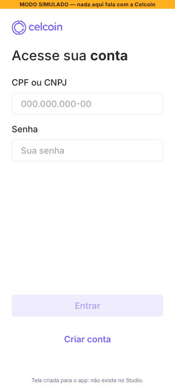 <b>Login</b> <code>#/login</code></td><td align="center" valign="top" width="33%">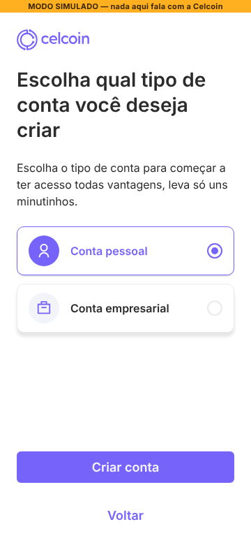 <b>Tipo de conta</b> <code>#/cadastro</code></td><td align="center" valign="top" width="33%">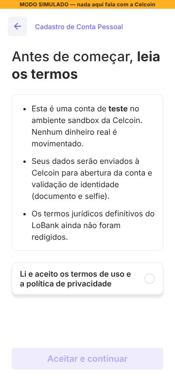 <b>Termos</b> <code>#/cadastro/termos</code></td></tr>
<tr><td align="center" valign="top" width="33%">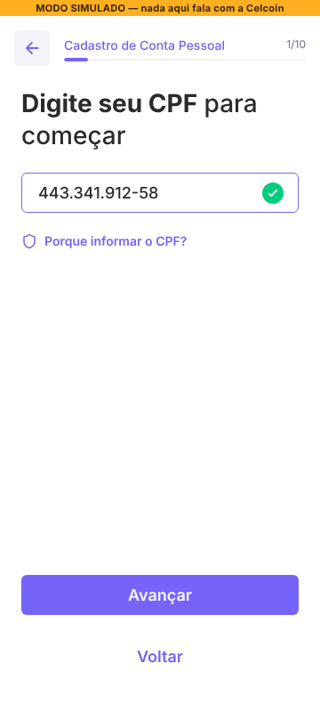 <b>CPF</b> <code>#/cadastro/cpf</code></td><td align="center" valign="top" width="33%">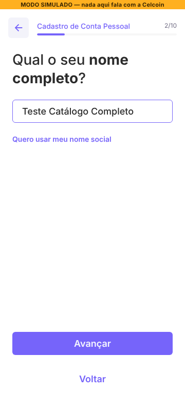 <b>Nome completo</b> <code>#/cadastro/nome</code></td><td align="center" valign="top" width="33%">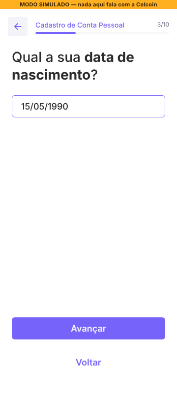 <b>Data de nascimento</b> <code>#/cadastro/nascimento</code></td></tr>
<tr><td align="center" valign="top" width="33%">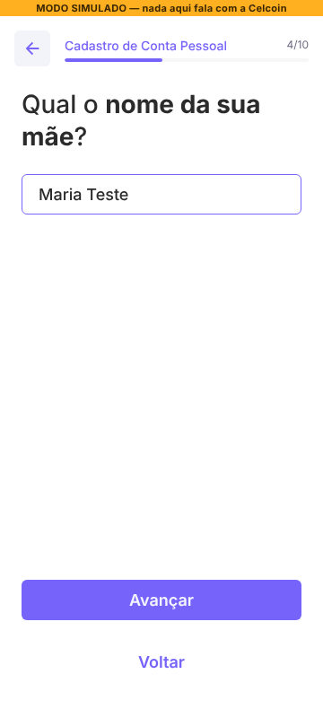 <b>Nome da mãe</b> <code>#/cadastro/mae</code></td><td align="center" valign="top" width="33%">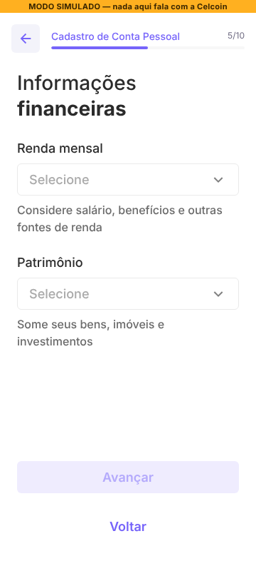 <b>Dados financeiros</b> <code>#/cadastro/financeiro</code></td><td align="center" valign="top" width="33%">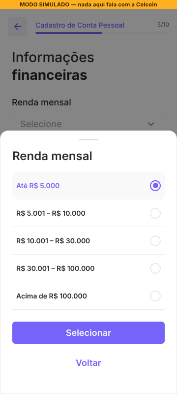 <b>Dados financeiros: escolher renda</b> <code>#/cadastro/financeiro</code></td></tr>
<tr><td align="center" valign="top" width="33%">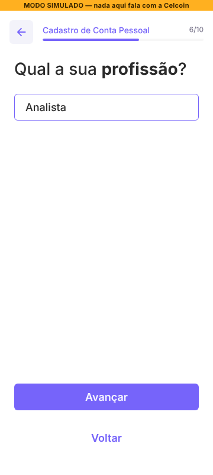 <b>Profissão</b> <code>#/cadastro/profissao</code></td><td align="center" valign="top" width="33%">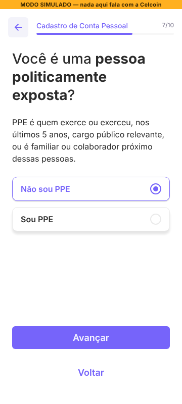 <b>Pessoa politicamente exposta</b> <code>#/cadastro/ppe</code></td><td align="center" valign="top" width="33%">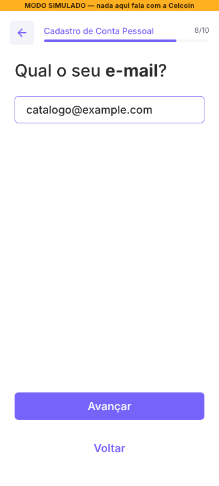 <b>E-mail</b> <code>#/cadastro/email</code></td></tr>
<tr><td align="center" valign="top" width="33%">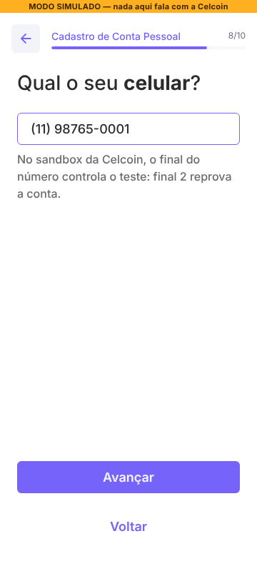 <b>Celular</b> <code>#/cadastro/telefone</code></td><td align="center" valign="top" width="33%">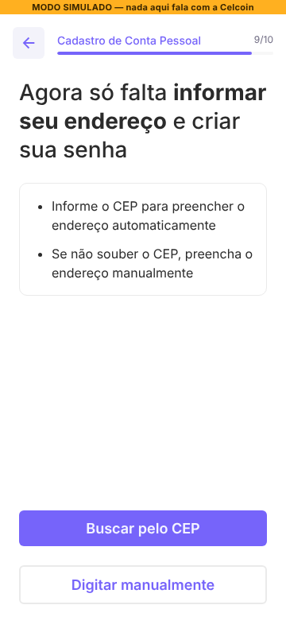 <b>Endereço: buscar ou digitar</b> <code>#/cadastro/endereco</code></td><td align="center" valign="top" width="33%">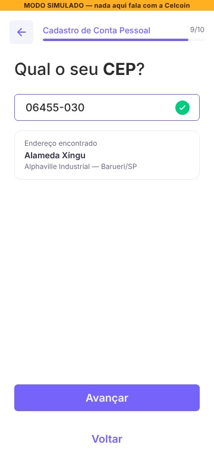 <b>Endereço: CEP encontrado</b> <code>#/cadastro/endereco/cep</code></td></tr>
<tr><td align="center" valign="top" width="33%">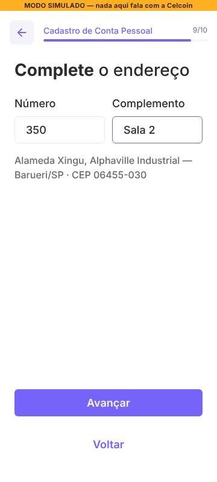 <b>Endereço: número e complemento</b> <code>#/cadastro/endereco/complemento</code></td><td align="center" valign="top" width="33%">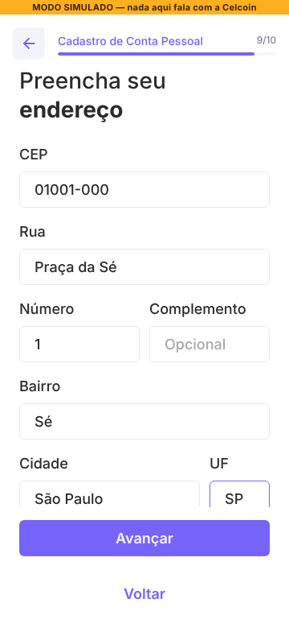 <b>Endereço manual</b> <code>#/cadastro/endereco/manual</code></td><td align="center" valign="top" width="33%">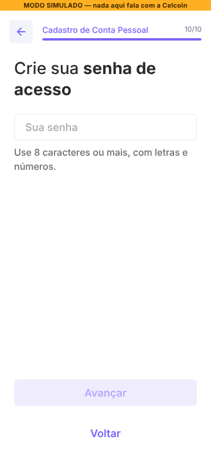 <b>Senha de acesso</b> <code>#/cadastro/senha</code></td></tr>
<tr><td align="center" valign="top" width="33%">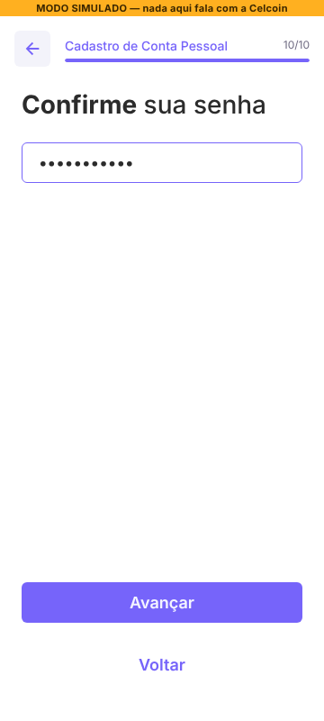 <b>Confirmar senha</b> <code>#/cadastro/senha/confirmar</code></td><td align="center" valign="top" width="33%">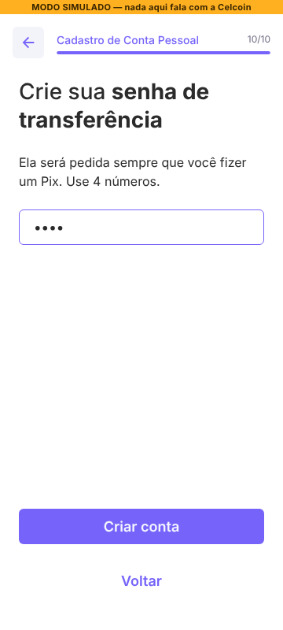 <b>Senha de transferência</b> <code>#/cadastro/senha-transferencia</code></td><td align="center" valign="top" width="33%">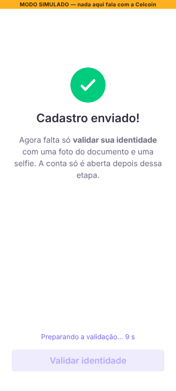 <b>Cadastro enviado (espera de 10 s)</b> <code>#/cadastro/sucesso</code></td></tr>
<tr><td align="center" valign="top" width="33%">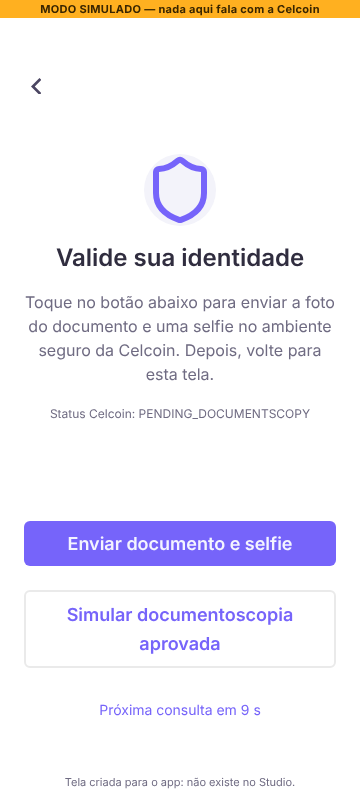 <b>Validação de identidade</b> <code>#/validacao</code></td></tr>
</table>

## Cadastro PJ (MEI e LTDA)

Detalhamento (origem no Studio, alteração e motivo): [Evidências de telas › Cadastro PJ (MEI e LTDA)](Evidencias%20de%20telas.md#cadastro-pj-mei-e-ltda)

<table>
<tr><td align="center" valign="top" width="33%">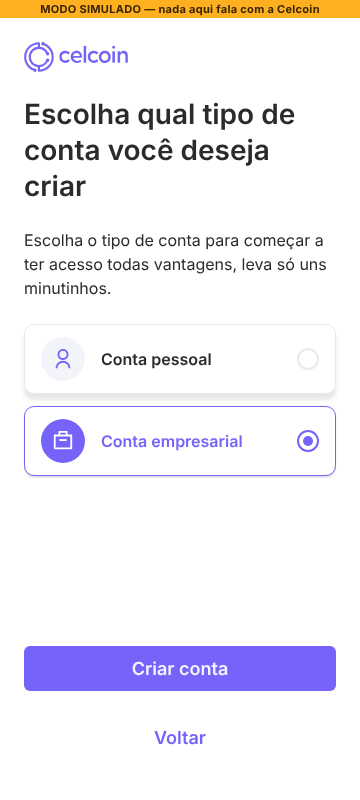 <b>Tipo de conta PJ</b> <code>#/cadastro</code></td><td align="center" valign="top" width="33%">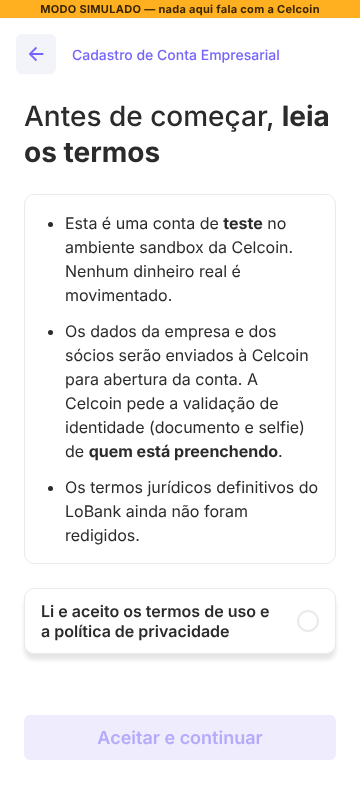 <b>Termos PJ</b> <code>#/cadastro-pj/termos</code></td><td align="center" valign="top" width="33%">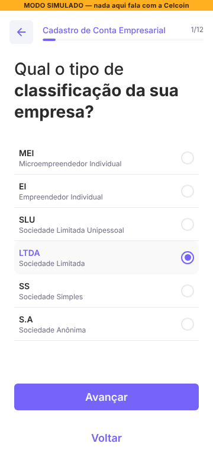 <b>Tipo de empresa</b> <code>#/cadastro-pj/tipo</code></td></tr>
<tr><td align="center" valign="top" width="33%">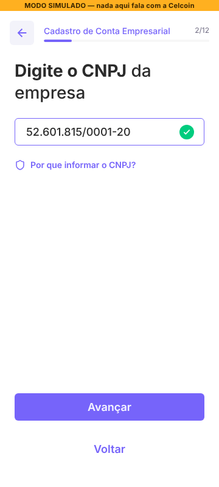 <b>CNPJ</b> <code>#/cadastro-pj/cnpj</code></td><td align="center" valign="top" width="33%">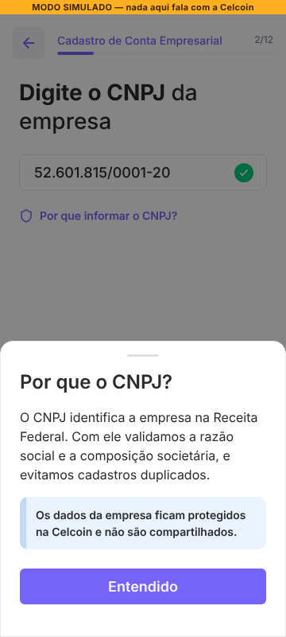 <b>Por que pedimos o CNPJ</b> <code>#/cadastro-pj/cnpj</code></td><td align="center" valign="top" width="33%">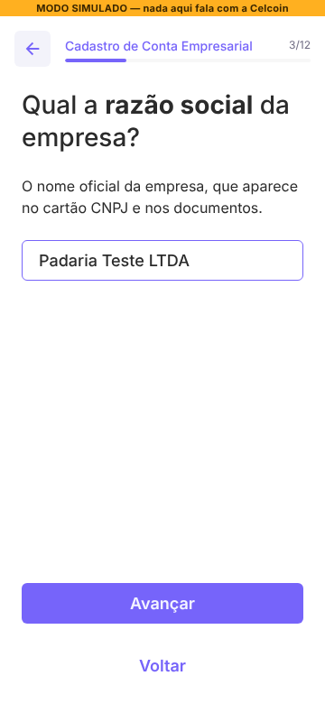 <b>Razão social</b> <code>#/cadastro-pj/razao-social</code></td></tr>
<tr><td align="center" valign="top" width="33%">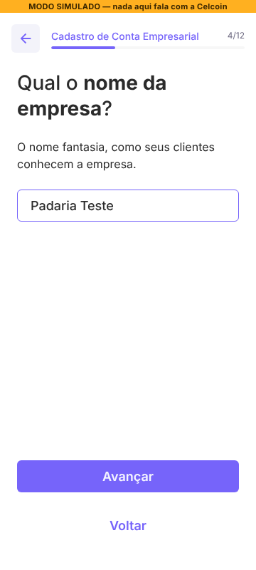 <b>Nome fantasia</b> <code>#/cadastro-pj/nome</code></td><td align="center" valign="top" width="33%">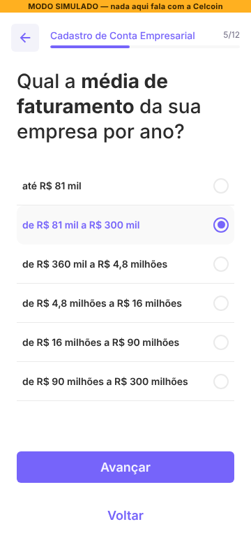 <b>Faturamento</b> <code>#/cadastro-pj/faturamento</code></td><td align="center" valign="top" width="33%">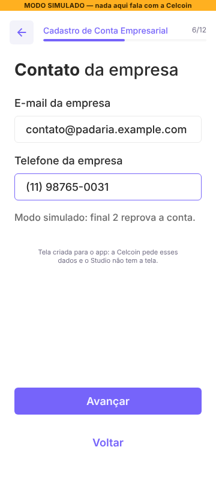 <b>Contato da empresa</b> <code>#/cadastro-pj/contato</code></td></tr>
<tr><td align="center" valign="top" width="33%">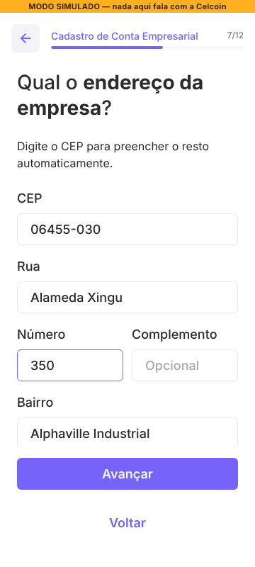 <b>Endereço da empresa</b> <code>#/cadastro-pj/endereco</code></td><td align="center" valign="top" width="33%">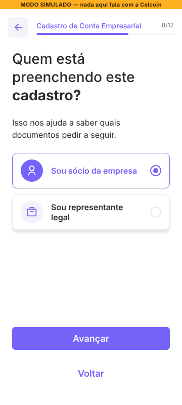 <b>Quem está abrindo a conta</b> <code>#/cadastro-pj/quem</code></td><td align="center" valign="top" width="33%">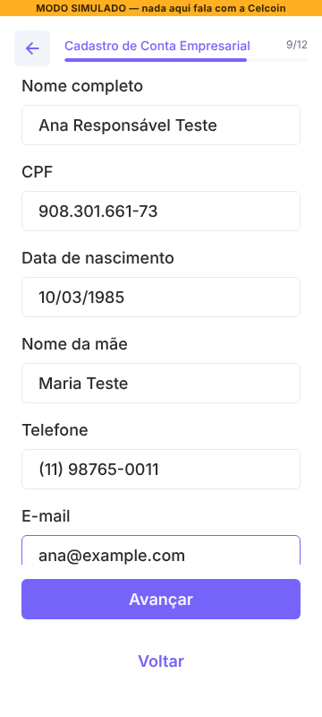 <b>Seus dados (responsável)</b> <code>#/cadastro-pj/seus-dados</code></td></tr>
<tr><td align="center" valign="top" width="33%">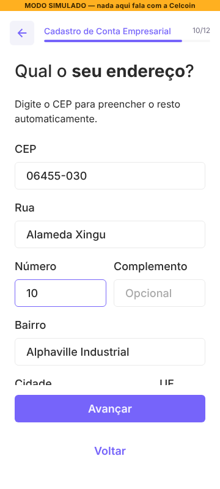 <b>Seu endereço</b> <code>#/cadastro-pj/seu-endereco</code></td><td align="center" valign="top" width="33%">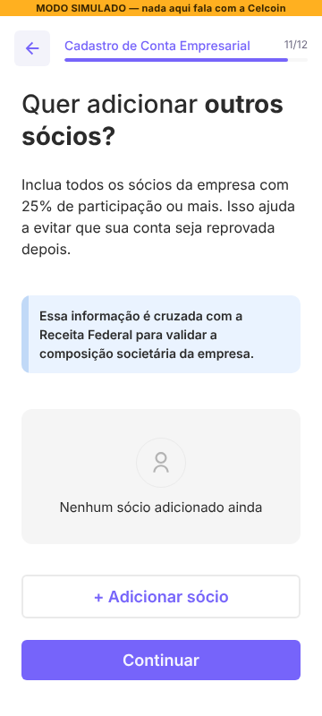 <b>Sócios (vazio)</b> <code>#/cadastro-pj/socios</code></td><td align="center" valign="top" width="33%">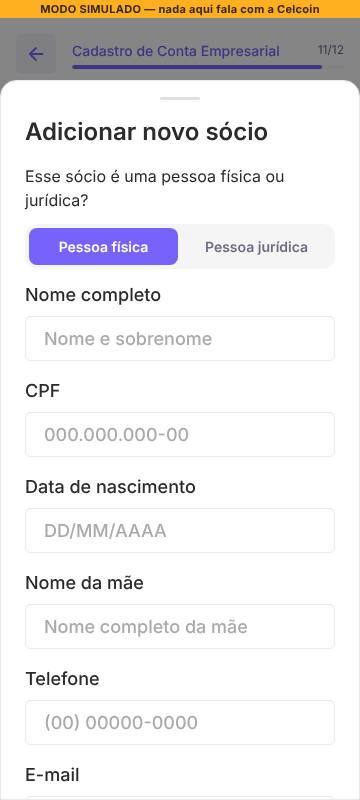 <b>Adicionar sócio PF</b> <code>#/cadastro-pj/socios</code></td></tr>
<tr><td align="center" valign="top" width="33%"> <b>Adicionar sócio PJ</b> <code>#/cadastro-pj/socios</code></td><td align="center" valign="top" width="33%">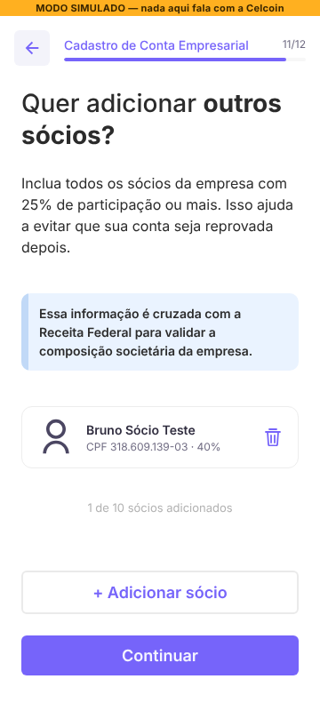 <b>Sócios (lista)</b> <code>#/cadastro-pj/socios</code></td><td align="center" valign="top" width="33%"> <b>Cadastro PJ enviado</b> <code>#/cadastro/sucesso</code></td></tr>
<tr><td align="center" valign="top" width="33%"> <b>Validação: link do responsável</b> <code>#/validacao</code></td><td align="center" valign="top" width="33%">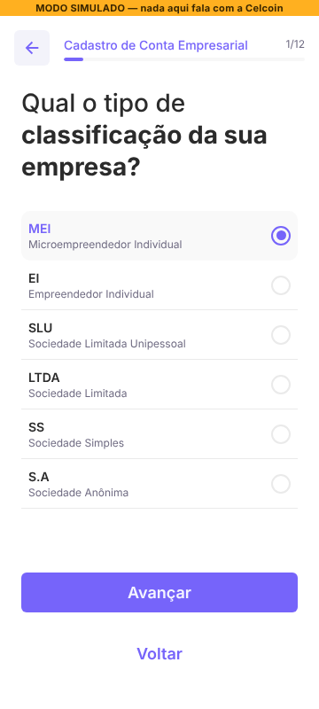 <b>Tipo de empresa: MEI</b> <code>#/cadastro-pj/tipo</code></td></tr>
</table>

## Home e Minha conta

Detalhamento (origem no Studio, alteração e motivo): [Evidências de telas › Home e Minha conta](Evidencias%20de%20telas.md#home-e-minha-conta)

<table>
<tr><td align="center" valign="top" width="33%">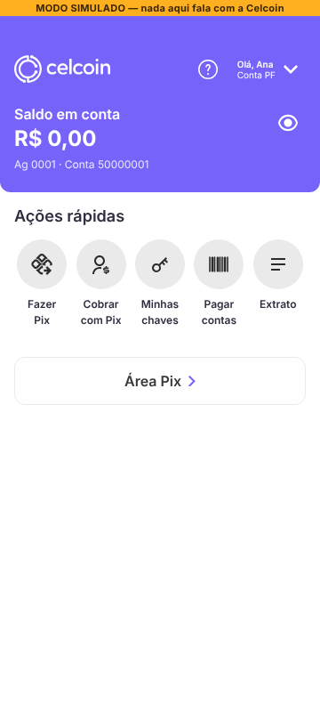 <b>Home sem saldo</b> <code>#/home</code></td><td align="center" valign="top" width="33%"> <b>Home</b> <code>#/home</code></td><td align="center" valign="top" width="33%"> <b>Fazer Pix: escolher forma</b> <code>#/home</code></td></tr>
<tr><td align="center" valign="top" width="33%">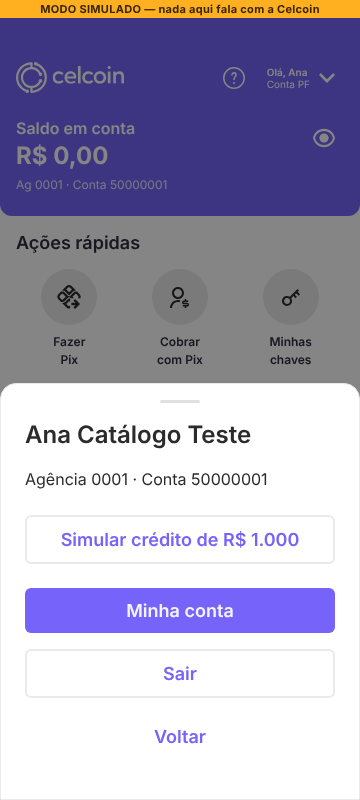 <b>Menu</b> <code>#/home</code></td><td align="center" valign="top" width="33%">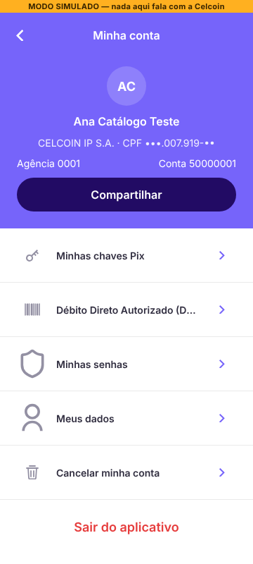 <b>Minha conta</b> <code>#/minha-conta</code></td><td align="center" valign="top" width="33%">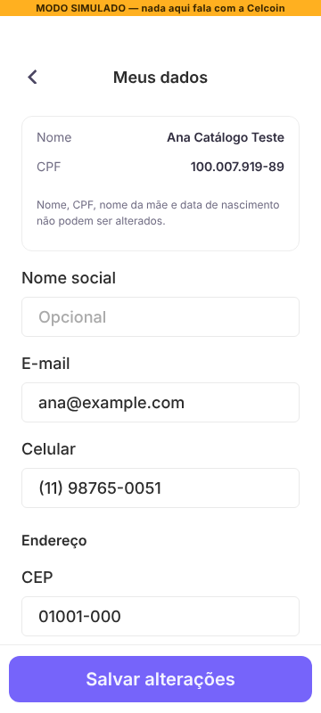 <b>Meus dados</b> <code>#/minha-conta/dados</code></td></tr>
<tr><td align="center" valign="top" width="33%">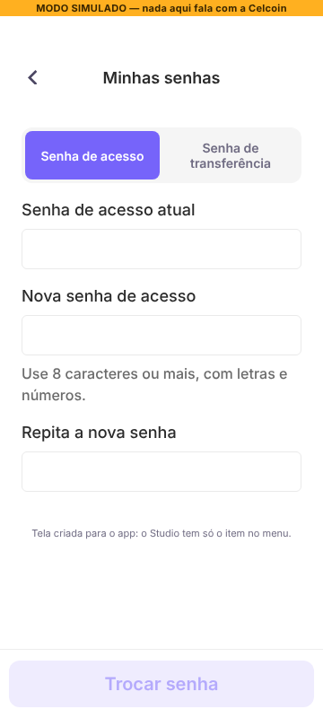 <b>Minhas senhas</b> <code>#/minha-conta/senhas</code></td><td align="center" valign="top" width="33%">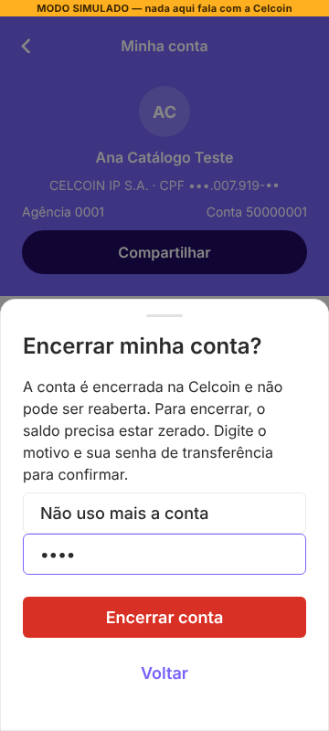 <b>Cancelar minha conta</b> <code>#/minha-conta</code></td><td align="center" valign="top" width="33%">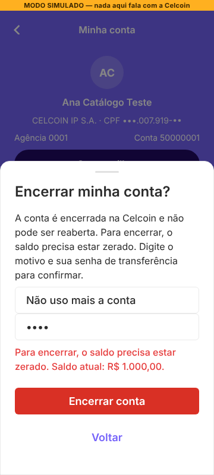 <b>Cancelar conta: saldo não zerado</b> <code>#/minha-conta</code></td></tr>
<tr><td align="center" valign="top" width="33%">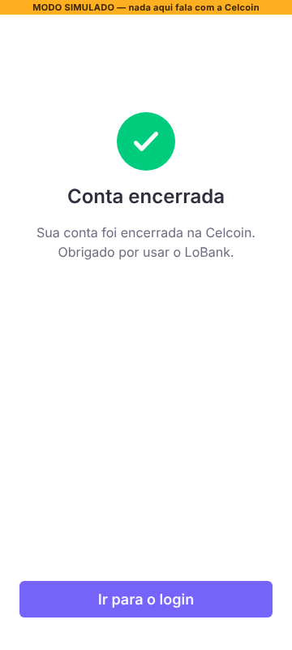 <b>Conta encerrada</b> <code>#/conta-encerrada</code></td></tr>
</table>

## Pix: chaves e envio por chave

Detalhamento (origem no Studio, alteração e motivo): [Evidências de telas › Pix: chaves e envio por chave](Evidencias%20de%20telas.md#pix-chaves-e-envio-por-chave)

<table>
<tr><td align="center" valign="top" width="33%">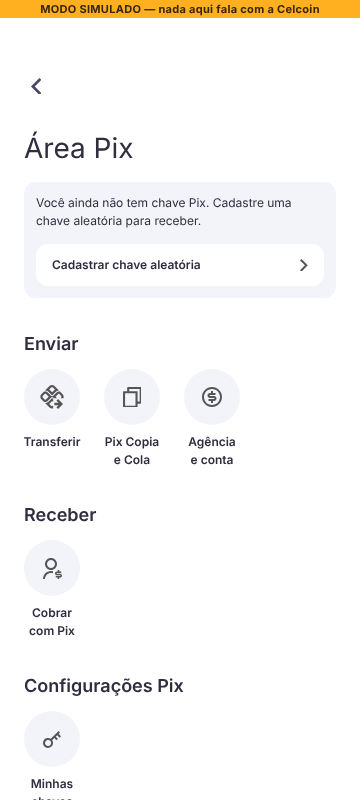 <b>Área Pix</b> <code>#/pix</code></td><td align="center" valign="top" width="33%">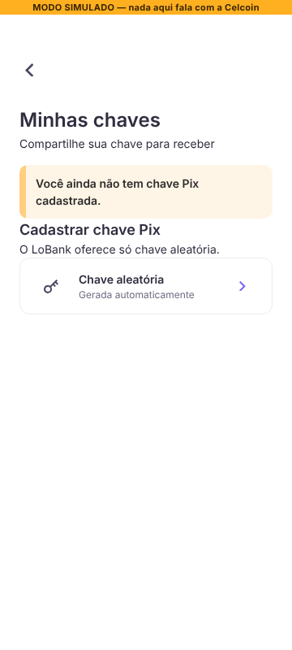 <b>Minhas chaves (vazio)</b> <code>#/pix/chaves</code></td><td align="center" valign="top" width="33%">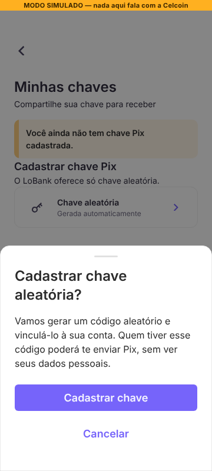 <b>Criar chave aleatória</b> <code>#/pix/chaves</code></td></tr>
<tr><td align="center" valign="top" width="33%"> <b>Minhas chaves</b> <code>#/pix/chaves</code></td><td align="center" valign="top" width="33%"> <b>Chave não encontrada</b> <code>#/pix/transferir</code></td><td align="center" valign="top" width="33%"> <b>Chave do destinatário</b> <code>#/pix/transferir</code></td></tr>
<tr><td align="center" valign="top" width="33%"> <b>Valor do Pix</b> <code>#/pix/transferir/valor</code></td><td align="center" valign="top" width="33%"> <b>Revisão do Pix</b> <code>#/pix/transferir/revisao</code></td><td align="center" valign="top" width="33%"> <b>Senha de transferência</b> <code>#/pix/transferir/revisao</code></td></tr>
<tr><td align="center" valign="top" width="33%"> <b>Pix: consultando em 10 s</b> <code>#/pix/transferencia/:id</code></td><td align="center" valign="top" width="33%"> <b>Pix enviado</b> <code>#/pix/transferencia/:id</code></td><td align="center" valign="top" width="33%"> <b>Comprovante Pix</b> <code>#/comprovante/:id</code></td></tr>
<tr><td align="center" valign="top" width="33%"> <b>Pix: saldo insuficiente</b> <code>#/pix/transferir/saldo-insuficiente</code></td></tr>
</table>

## Pix Copia e Cola e transferência por agência e conta

Detalhamento (origem no Studio, alteração e motivo): [Evidências de telas › Pix Copia e Cola e transferência por agência e conta](Evidencias%20de%20telas.md#pix-copia-e-cola-e-transferência-por-agência-e-conta)

<table>
<tr><td align="center" valign="top" width="33%"> <b>Copia e Cola</b> <code>#/pix/copia-e-cola</code></td><td align="center" valign="top" width="33%"> <b>Copia e Cola: código inválido</b> <code>#/pix/copia-e-cola</code></td><td align="center" valign="top" width="33%"> <b>Revisão com valor do QR Code</b> <code>#/pix/transferir/revisao</code></td></tr>
<tr><td align="center" valign="top" width="33%"> <b>Revisão de cobrança com vencimento</b> <code>#/pix/transferir/revisao</code></td><td align="center" valign="top" width="33%"> <b>Revisão de cobrança imediata</b> <code>#/pix/transferir/revisao</code></td><td align="center" valign="top" width="33%"> <b>Agência e conta: banco</b> <code>#/transferir/conta</code></td></tr>
<tr><td align="center" valign="top" width="33%"> <b>Agência e conta: buscar banco</b> <code>#/transferir/conta</code></td><td align="center" valign="top" width="33%"> <b>Agência e conta: dados (vazio)</b> <code>#/transferir/conta/dados</code></td><td align="center" valign="top" width="33%"> <b>Agência e conta: dados</b> <code>#/transferir/conta/dados</code></td></tr>
<tr><td align="center" valign="top" width="33%"> <b>Agência e conta: minha conta</b> <code>#/transferir/conta/dados</code></td><td align="center" valign="top" width="33%"> <b>Agência e conta: tipo de conta</b> <code>#/transferir/conta/tipo</code></td><td align="center" valign="top" width="33%"> <b>Agência e conta: revisão</b> <code>#/pix/transferir/revisao</code></td></tr>
<tr><td align="center" valign="top" width="33%"> <b>Comprovante por agência e conta</b> <code>#/comprovante/:id</code></td></tr>
</table>

## Receber (QR Code)

Detalhamento (origem no Studio, alteração e motivo): [Evidências de telas › Receber (QR Code)](Evidencias%20de%20telas.md#receber-qr-code)

<table>
<tr><td align="center" valign="top" width="33%"> <b>Receber: único ou múltiplos</b> <code>#/receber</code></td><td align="center" valign="top" width="33%"> <b>Receber: valor</b> <code>#/receber/valor</code></td><td align="center" valign="top" width="33%"> <b>Receber: revisar cobrança</b> <code>#/receber/revisar</code></td></tr>
<tr><td align="center" valign="top" width="33%"> <b>Receber: QR Code</b> <code>#/receber/qrcode</code></td><td align="center" valign="top" width="33%"> <b>Receber múltiplos: valor</b> <code>#/receber/valor</code></td><td align="center" valign="top" width="33%"> <b>Receber múltiplos: sem valor fixo</b> <code>#/receber/revisar</code></td></tr>
</table>

## Extrato

Detalhamento (origem no Studio, alteração e motivo): [Evidências de telas › Extrato](Evidencias%20de%20telas.md#extrato)

<table>
<tr><td align="center" valign="top" width="33%"> <b>Extrato vazio</b> <code>#/extrato</code></td><td align="center" valign="top" width="33%"> <b>Extrato</b> <code>#/extrato</code></td><td align="center" valign="top" width="33%"> <b>Filtros</b> <code>#/extrato/filtros</code></td></tr>
<tr><td align="center" valign="top" width="33%"> <b>Filtros: período personalizado</b> <code>#/extrato/filtros</code></td><td align="center" valign="top" width="33%"> <b>Extrato filtrado</b> <code>#/extrato</code></td><td align="center" valign="top" width="33%"> <b>Baixar extrato</b> <code>#/extrato</code></td></tr>
<tr><td align="center" valign="top" width="33%"> <b>Extrato com diferença de saldo</b> <code>#/extrato</code></td><td align="center" valign="top" width="33%"> <b>Detalhe da diferença de saldo</b> <code>#/extrato</code></td></tr>
</table>

## Pagamento de contas (boleto)

Detalhamento (origem no Studio, alteração e motivo): [Evidências de telas › Pagamento de contas (boleto)](Evidencias%20de%20telas.md#pagamento-de-contas-boleto)

<table>
<tr><td align="center" valign="top" width="33%"> <b>Formas de pagamento</b> <code>#/boleto</code></td><td align="center" valign="top" width="33%"> <b>Digitar código (incompleto)</b> <code>#/boleto/codigo</code></td><td align="center" valign="top" width="33%"> <b>Código inválido</b> <code>#/boleto/codigo</code></td></tr>
<tr><td align="center" valign="top" width="33%"> <b>Dados incompletos do banco emissor</b> <code>#/boleto/codigo</code></td><td align="center" valign="top" width="33%"> <b>Confirmar valor: boleto vencido</b> <code>#/boleto/confirmar</code></td><td align="center" valign="top" width="33%"> <b>Confirmar valor: ver mais</b> <code>#/boleto/confirmar</code></td></tr>
<tr><td align="center" valign="top" width="33%"> <b>Informar valor: fora do intervalo</b> <code>#/boleto/valor</code></td><td align="center" valign="top" width="33%"> <b>Confirmar valor</b> <code>#/boleto/confirmar</code></td><td align="center" valign="top" width="33%"> <b>Senha de transferência</b> <code>#/boleto/confirmar</code></td></tr>
<tr><td align="center" valign="top" width="33%"> <b>Pagamento em processamento</b> <code>#/boleto/pagamento/:id</code></td><td align="center" valign="top" width="33%"> <b>Pagamento concluído</b> <code>#/boleto/pagamento/:id</code></td><td align="center" valign="top" width="33%"> <b>Comprovante do boleto</b> <code>#/boleto/comprovante/:id</code></td></tr>
<tr><td align="center" valign="top" width="33%"> <b>Falha no pagamento com valor debitado</b> <code>#/boleto/pagamento/:id</code></td><td align="center" valign="top" width="33%"> <b>Comprovante: pagamento não concluído</b> <code>#/boleto/comprovante/:id</code></td><td align="center" valign="top" width="33%"> <b>Saldo insuficiente</b> <code>#/boleto/saldo-insuficiente</code></td></tr>
</table>

## DDA (Débito Direto Autorizado)

Detalhamento (origem no Studio, alteração e motivo): [Evidências de telas › DDA (Débito Direto Autorizado)](Evidencias%20de%20telas.md#dda-débito-direto-autorizado)

<table>
<tr><td align="center" valign="top" width="33%"> <b>Ative o DDA (termos)</b> <code>#/dda/termos</code></td><td align="center" valign="top" width="33%"> <b>Confira seus dados</b> <code>#/dda/cadastro</code></td><td align="center" valign="top" width="33%"> <b>Ativando o DDA</b> <code>#/dda/processando</code></td></tr>
<tr><td align="center" valign="top" width="33%"> <b>DDA ativado</b> <code>#/dda/sucesso</code></td><td align="center" valign="top" width="33%"> <b>Meus boletos (vazia)</b> <code>#/dda/boletos</code></td><td align="center" valign="top" width="33%"> <b>Boletos de teste pedidos</b> <code>#/dda/boletos</code></td></tr>
<tr><td align="center" valign="top" width="33%"> <b>Meus boletos</b> <code>#/dda/boletos</code></td><td align="center" valign="top" width="33%"> <b>Filtro: vencidos</b> <code>#/dda/boletos</code></td><td align="center" valign="top" width="33%"> <b>Opções</b> <code>#/dda/boletos</code></td></tr>
<tr><td align="center" valign="top" width="33%"> <b>Sobre o DDA</b> <code>#/dda/termos-info</code></td><td align="center" valign="top" width="33%"> <b>Detalhe do boleto</b> <code>#/dda/boleto/:id</code></td><td align="center" valign="top" width="33%"> <b>Pagar: código não reconhecido</b> <code>#/dda/boleto/:id</code></td></tr>
<tr><td align="center" valign="top" width="33%"> <b>Minha conta: DDA ativo</b> <code>#/minha-conta</code></td><td align="center" valign="top" width="33%"> <b>Sair do DDA: senha incorreta</b> <code>#/minha-conta</code></td><td align="center" valign="top" width="33%"> <b>Saindo do DDA</b> <code>#/dda/processando</code></td></tr>
<tr><td align="center" valign="top" width="33%"> <b>DDA desativado</b> <code>#/dda/desativado</code></td><td align="center" valign="top" width="33%"> <b>Erro na adesão</b> <code>#/dda/erro</code></td><td align="center" valign="top" width="33%"> <b>Não conseguimos confirmar o DDA</b> <code>#/dda/indisponivel</code></td></tr>
<tr><td align="center" valign="top" width="33%"> <b>Sem confirmação da Celcoin</b> <code>#/dda/sem-resposta</code></td></tr>
</table>

## Devolução de Pix

Detalhamento (origem no Studio, alteração e motivo): [Evidências de telas › Devolução de Pix](Evidencias%20de%20telas.md#devolução-de-pix)

<table>
<tr><td align="center" valign="top" width="33%"> <b>Recebimento Pix</b> <code>#/devolucao</code></td><td align="center" valign="top" width="33%"> <b>Comprovante do Pix recebido</b> <code>#/devolucao</code></td><td align="center" valign="top" width="33%"> <b>Devolver Pix</b> <code>#/devolucao/valor</code></td></tr>
<tr><td align="center" valign="top" width="33%"> <b>Devolver Pix: preenchido</b> <code>#/devolucao/valor</code></td><td align="center" valign="top" width="33%"> <b>Resumo da devolução</b> <code>#/devolucao/resumo</code></td><td align="center" valign="top" width="33%"> <b>Senha da devolução</b> <code>#/devolucao/resumo</code></td></tr>
<tr><td align="center" valign="top" width="33%"> <b>Devolução em processamento</b> <code>#/devolucao/resultado/:id</code></td><td align="center" valign="top" width="33%"> <b>Devolução concluída</b> <code>#/devolucao/resultado/:id</code></td><td align="center" valign="top" width="33%"> <b>Comprovante de devolução</b> <code>#/devolucao/resultado/:id</code></td></tr>
</table>

## Rotas sem print

Todas as rotas do app aparecem no catálogo.
